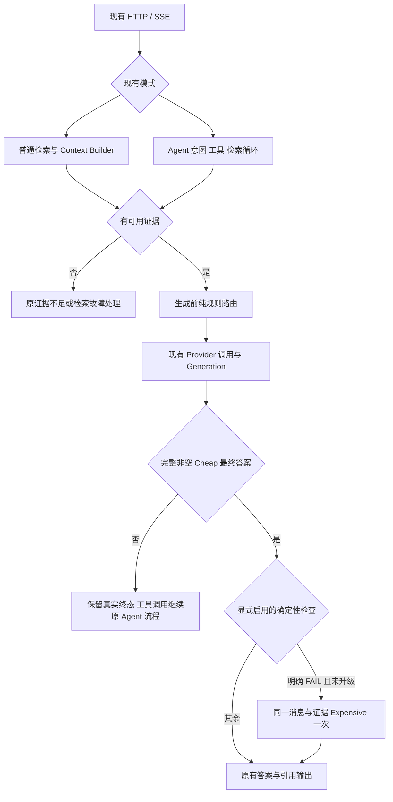

# 动态模型路由 V1：实施完成与审核报告

日期：2026-11-02。仓库 `D:/RAG knowledge`，分支 `codex/pdf-parser-migration`，基线 HEAD `8fca08ad669b3ba8b2fb6fe0da50cb9c2c54b48d`。本报告描述当前未提交工作区；不代表 ECS 正式服务已经部署。

## 1. 交付范围与结论

在已有未提交路由实现上完成规则、普通生成/Agent 接线和统计入口。路由默认 **OFF**；没有修改正式 `LLM_MODEL`、检索算法/权重、Rerank、Context Builder、Gold 或生成 Prompt，没有新增严格语义/数值校验。没有提交、推送、切换正式服务或发送真实模型请求。

- PASS：四种模式、六类可解释特征、UNKNOWN 区间处理、角色绑定、一次质量升级、调用异常不重发、普通 ChatService 流式入口的替身集成。
- PASS：实际 Langfuse SDK + 内存导出器验证调用与 Generation 对应、父子关系、模型身份/usage/结束状态、正文保护和观测开关等价性；Provider 为替身。
- NOT RUN：本版真实 Provider、HTTP 网络入口、ECS 新代码部署、Langfuse Cloud 回读、完整三臂质量/节费实验。
- UNKNOWN：风险分数的概率校准、最佳阈值、全量正确率收益、实际金额和真实路由 P95。不能把规则选模比例称为节费。

完成状态限于本轮代码、配置、定向测试及实验方案；正式启用须单独审核。完整通用预算/外发权限门不在该旧仓库中，不假称已存在。

## 2. 依据哪些实验结果制定规则

最新已复核的 36 对回答来自 180 题流程中被初筛选中的问题，含 29 道初始题和 7 道追问，并非随机样本。Cheap 为 `Qwen/Qwen3.5-4B`（关闭思考），Expensive 为 `zai-org/GLM-5.3-Flash`。

|Gold 覆盖比较|数量/36|解释|
|---|---:|---|
|Expensive 更好|14|其中 11 道达到 PASS，3 道只改善到 PARTIAL|
|Cheap 更好|1|贵模型不保证更正确|
|相同覆盖等级|19|不代表忠实度、附加事实与引用均相同|
|UNKNOWN|2|实际前文导致指代冲突，不强行排序|

本次根据错误类型补充通用的字段对应、数值条件、计算、比较、集合操作、排序及实际历史指代信号。没有按 qid、答案、Gold、特定项目名称写规则，也没有将复核标签喂给在线模型。

两模型都失败的来源缺失题说明：贵模型不能补回没送达的证据。单字段长表格也可能由 Cheap 正确完成，因此保留较低的 L/M 单项权重，不把所有长文或表格一律送贵模型。神经网络、图表等案例也包含已有图像描述质量问题，不能仅归因于模型。

历史逐题依据保留在受限 `var/dynamic-routing-20261101/36题逐题复核账本.json`。引用和附加事实只完成部分核验；本报告不提高其验证等级，也不把它们当作未经污染的留出集。

## 3. 调用链与边界



- `chat.py::ChatService._chat_stream_normal` → `grounded_generation.generate_grounded_candidate` → `_route_generation` → 原 SDK 调用。当前普通知识库生成使用缓冲后发送，不声称测到模型流式 TTFT。关闭 grounded generation 时保留原摘录路径，无新模型请求。
- `agent_workflow.py::AgentWorkflow.agent_node/_route_post_retrieval_model`：只在检索 SUCCESS、资料可用后选回答模型；意图分析、首次工具规划、检索评分和工具参数保持原逻辑。Tool Call 不是最终答案，不做答案质量升级。
- Agent 使用 `router_escalations_used` 跨轮保持升级上限；Expensive 不递归升级。
- `_role_service` 读取服务端 active LLM 类型的 CustomModel ID、实际名称与 endpoint，不能让用户消息随意指定云端模型或沿用错误供应商凭据。

本仓库没有 E:/RAG quention 的 Quick/Smart、新版 KnowledgeGateway、月度预算预留或通用 GenerationBudget。现有 Scope、知识工具参数和调用预算约束保持不变；`RAG_ROUTER_ALLOW_MODEL_CALLS=true` 只是显式操作开关，不是来源级外发许可或金额预算系统。需要这些门禁的部署不能仅靠该开关宣称安全就绪。

## 4. 特征与评分规则

源码 `model_router.py::extract_features/_question_signals/score_interval/decide_route`，版本 `rule-router-v1.2-reviewed-signals-uncalibrated`。

|特征|计算依据|状态与初始权重|
|---|---|---|
|T|综合、计算、集合操作、字段对应四类任务信号，类别数/2，上限1|ESTIMATED，0.25|
|C|字段对应、排序、输出约束、多条件、数字加单位条件，类别数/3，上限1|ESTIMATED，0.20|
|J|比较、计算、集合操作，另计明确推理/因果提示，上限1|ESTIMATED，0.25|
|D|已选来源/段落身份与数量、跨文档提示；捕获到实际历史且有指代时增加依赖信号|ESTIMATED；身份或所需历史缺失 UNKNOWN，0.10|
|L|真实请求消息文本字符总数/12000；只计一次；多模态负载未知不捏造 Token|ESTIMATED/UNKNOWN，0.10|
|M|实际媒体块、图片/OCR/描述类型、Sheet/单元格/表格定位及文本表格结构|ESTIMATED/UNKNOWN，0.10|

实际文字长度、证据数量、来源数量/下界和 Top1 原始分数另列。BM25、Vector、Rerank 分数未经校准，**不直接变为相关性概率**。候选冲突和证据完整性未观测时保持 UNKNOWN；调用方显式提供时才参与 D，显式完整性为0会拒绝生成路由。当前正式检索入口未提供 Gold 完整性，不从“命中页/条数”推断它。

缺失问题文本时 T/C/J 为 UNKNOWN；多模态未测负载为 UNKNOWN；不能用缺失字段填0表示简单。

加权下界 = 已知特征加权和 / 总权重；上界 = 下界 + UNKNOWN 特征权重 / 总权重。上界低于阈值选 Cheap；下界达到阈值选 Expensive；跨阈值按显式 UNKNOWN policy，默认 BASELINE。区间是缺失特征范围，不是统计置信区间。BASELINE 必须单列，不能冒充选中了 Cheap。

当前阈值仍为未校准的 0.5；0.35 仅列为后续实验候选，不声称最佳。中文/英文关键词是弱启发式：可能漏掉隐含推理或误判约束，不能代替质量评测。

## 5. 配置、模型与升级状态机

模板：`config/router-v1.env.example`。角色默认更新为本次最近对照的 Qwen/GLM；**只影响显式开启的 Router，OFF 继续使用原模型**。Cheap thinking=false；Expensive thinking 留空保持供应商原参数。普通 SDK 的 extra_body 和 Agent 的绑定参数均有测试，实际 Provider 对该版本的接受情况本轮 NOT RUN。

|模式|行为|
|---|---|
|OFF|不提取路由特征，不改变原模型/Prompt/调用次数|
|CHEAP_ONLY|仅在证据可用时固定 Cheap，无质量升级|
|EXPENSIVE_ONLY|仅在证据可用时固定 Expensive，无递归升级|
|DYNAMIC|按规则选择；Cheap 完成后可有一次确定性质量升级|

质量检查默认 NONE。可选 REFERENCE_RANGE 仅检测显式 `[n]` 是否越出实际引用范围；缺引用 UNKNOWN，不检查句式、事实、数值与 Gold，不启动额外 Judge。普通生成也允许受信任调用方传入确定性回调，异常或非有效结果不触发升级。

|状态|处理|
|---|---|
|QUALITY_ESCALATION|完整非空 Cheap、身份确认匹配、明确检查 FAIL、尚未升级；同 Prompt/证据调用 Expensive 一次|
|RETRIEVAL_FAILURE|保留检索失败路径，不用贵模型遮掩；纯路由归一化 RETRIEVAL_ERROR 与 RETRIEVAL_FAILURE|
|INSUFFICIENT_EVIDENCE|无资料、低相关或明确完整性0不选新模型；走原不足说明|
|PROVIDER_FAILURE|明确故障，原异常/事件保持，无自动故障回退|
|TRUNCATED / UNKNOWN / EMPTY|保留真实状态，不当成确定性质量失败重发|
|CANCELLED|保留取消并传播原异常|
|TOOL_CALL|Agent 中间工具请求，与最终答案完成分开|

三个额外开关分别表达截断升级、故障回退和无依据回答升级，默认 false；V1 不实现这些额外收费策略，打开会明确报配置不支持，不能悄悄重发。`RAG_MODEL_ROUTER_OFF_FILE` 由服务端设置；创建该文件后下个路由边界回到 baseline，已发送的请求不被假装撤销。

## 6. Langfuse 与实验统计

复用原 `event/provider_generation/invoke_provider_model/capture_scope`，未增加第二套观测系统或重复 Generation。

- router.decision：规则版本、模式、角色、候选模型、阈值、权重、特征值/状态/方法、区间和选择原因。
- 原根 Trace / capture_scope：问题、qid、run_id、代码/数据身份，依照已有内容授权策略记录。路由事件不重复上传问题/私有证据全文。
- router.provider_identity：请求模型与 Provider 返回的模型分开；缺失 UNKNOWN，别名不一致 MISMATCH，不把请求配置当实际身份。
- router.quality / router.escalation / router.outcome：检查结果、升级原因与次数、实际终态、费用 UNKNOWN。
- 每次既有 Generation / provider.request_finished：真实调用的 usage、延迟、请求身份、参数、结束原因。传输 RETURNED 不等于最终答案 COMPLETED。普通升级返回 usage 仅合计双方都有的有效计数，不把缺失记0。

实际依赖版本：Langfuse **5.0.4**、OpenAI Python **3.40.0**、OpenTelemetry SDK **1.45.1**；复用现有环境，没有升级依赖。观测字段设计参照 [Langfuse metadata](https://langfuse.com/docs/observability/features/metadata) 和 [原生 Trace 最佳实践](https://langfuse.com/docs/observability/best-practices)。本轮 SDK 内存导出验证不是 Cloud 回读，不提供虚构 Cloud 链接。

`scripts/summarize_routing_experiment.py::summarize` 支持 CHEAP_ONLY / DYNAMIC / EXPENSIVE_ONLY；可传冻结 qid 清单，保留缺题槽位 UNKNOWN/NOT_RUN。PASS/PARTIAL/FAIL/UNKNOWN、执行/生成/finish reason、升级已知/未知、Token/费用/延迟缺失数独立统计。P50 用中位数，P95 用 nearest-rank，必须同时看有效 n。

严格通过率为 PASS/(PASS+PARTIAL+FAIL)，确认通过/计划为 PASS/所有计划槽位。配对必须实验身份和实际消息/证据/前文 Hash 相同；缺臂、缺输入身份、输入不同分别标记，不把未执行的 Dynamic 反事实选择算成真实回答。费用币种不明、次数不全、计数缺失则 UNKNOWN；不输出未经核对的节费比例。

## 7. 修改文件

|文件|本轮作用|
|---|---|
|backend/app/services/model_router.py|六类规则补充、缺失问题/历史 UNKNOWN、配置边界、最新角色及状态|
|backend/app/services/grounded_generation.py|普通选模/升级；thinking、身份、真实终态和 usage|
|backend/app/services/agent_workflow.py|Agent 参数和身份透传、单次升级与中间 Tool Call 终态|
|config/router-v1.env.example|默认 OFF 的可审核配置模板|
|scripts/summarize_routing_experiment.py|三臂分母、缺失和可比性统计|
|backend/tests/test_model_router.py|纯规则与缺失值边界|
|backend/tests/test_dynamic_routing_generation.py|替身 Provider 调用与错误路径|
|backend/tests/test_dynamic_routing_agent.py|Agent 路由、工具、升级边界|
|backend/tests/test_dynamic_routing_chat.py|ChatService 流式入口到真实生成函数的替身集成|
|backend/tests/test_dynamic_routing_observability.py|原生 SDK 内存导出与观测等价性|
|backend/tests/test_routing_experiment_accounting.py|离线统计口径|
|docs/dynamic-routing-v1-experiment-plan.md|下一轮冻结实验方案，需另行批准调用|

未提交工作区另有本轮开始前的修改/未跟踪文件；没有覆盖或提交它们。本仓库没有根 progress.md 或 docs/adr，使用既有 `.planning/2026-11-01-dynamic-routing/` 记录。

## 8. 测试命令、退出码与原始证据

环境复用：D 仓库虚拟环境 + E 仓库现有只读 site-packages；没有安装依赖。单独 D 环境缺 langgraph，故组合环境必须明确列出，不能声称干净环境已通过。

```powershell
$env:PYTHONPATH='backend;E:\RAG quention\.venv\Lib\site-packages'
$env:DATABASE_URL='sqlite://'
$env:RAG_OBSERVABILITY_ENABLED='false'
$env:PYTHONIOENCODING='utf-8'
.venv/Scripts/python.exe -m pytest backend/tests/test_model_router.py backend/tests/test_dynamic_routing_generation.py backend/tests/test_dynamic_routing_agent.py backend/tests/test_dynamic_routing_chat.py backend/tests/test_dynamic_routing_observability.py backend/tests/test_routing_experiment_accounting.py backend/tests/test_agent_request_parameters.py backend/tests/test_agent_grounded_answer.py backend/tests/test_agent_evidence_guard.py backend/tests/test_provider_unknown.py backend/tests/test_normal_evidence_guard.py backend/tests/test_grounded_validation.py -q --tb=short -o addopts=
```

最终退出码 **0**：**200 passed，18 subtests passed，6 warnings，4.91s**。原始日志 `var/dynamic-routing-20261101/routing-v1-final-r2-20261102.log`。Warnings 为已有 Pydantic 配置弃用警告。所有 Provider 为替身，规则/统计离线；Langfuse 使用真实 SDK 的内存导出器，没有 Cloud 或付费模型调用。

初次合并命令退出1：199 passed、1 failed（SDK 字符串编码测试问题），原日志 `routing-v1-final-20261102.log` 保留。修复后用同一组合命令通过，不以单独通过掩盖组合失败。


关联广测中存在两个失败；使用 Git HEAD 的原 grounded_generation/agent_workflow 在相同依赖环境下重跑，仍为同样两项失败。执行 `python var/dynamic-routing-20261101/verify_router_baseline_failures.py`，退出码 **1，2 failed**；日志 `routing-v1-baseline-failures-20261102.log`。未实现的命令不得报告通过。

1. `test_image_only_never_generates_or_uses_caption[None]`：`context_builder.content_hash(None)` 抛 AttributeError。建议后续修复入库/上下文空值不变量；本轮禁止修改 Context Builder，保留 FAIL，不把它归因于新路由。
2. `test_candidate_snapshot_is_opt_in_and_events_do_not_contain_raw_text`：旧 `.txt` 快照预期和当前 capture 策略不一致。建议独立核对测试契约；没有为通过测试放松正文保护。

这些失败不被删除或伪造为已解决。初次本轮合并定向测试还发现 SDK finish_reason 在单独/组合环境中有原生字符串与 JSON 字符串编码差异；修正测试以检查同一语义值，未修改业务或脱敏策略，保留失败日志。

## 9. 后续最小实验与停止

详细方案见 [实验方案](dynamic-routing-v1-experiment-plan.md)。下一步建议先选已有冻结资料的 12 题：4 简单对照、4 多字段/比较/计算、2 历史依赖、2 证据不足。具体 qid 和实际输入核对后冻结，三臂最高48次回答请求；这只是待批预算上界，**本轮没有调用**。原先“贵模型只接错题”的授权不自动扩为全三臂收费实验。

同一消息、前文、证据和参数下比较质量与每题累计 Token/延迟；记录 BASIS/UNKNOWN 和模型身份。优先判断新增规则能否减少字段混用，而不牺牲简单题和拒答正确性，再考虑扩大范围。已经观察过的题只能作回顾性对照，不能称新的盲测留出集。

资源复用：复用本机既有虚拟环境、历史账本和计划；没有复制语料/Chroma/数据库、创建容器、安装依赖或新建 ECS 环境。新增只含源码、定向测试、报告和小日志；没有临时大数据副本需要删除，也没有删除历史资料。本轮未连接 ECS，ECS 磁盘前后测量 NOT RUN，不编造资源节省。

实现交付后停止，等待负责人审核；不自动进入真实实验、启用生产路由或推送。
