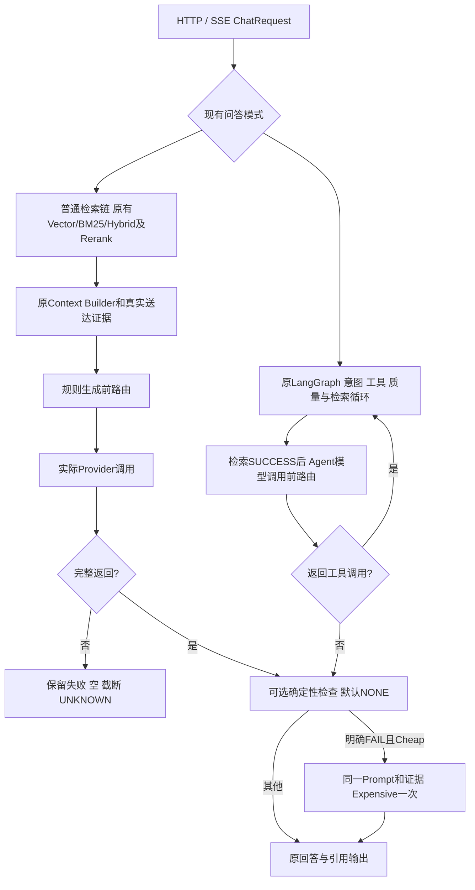

> 最新实施状态见 [2026-11-02 实施完成报告](dynamic-model-routing-v1-implementation-20261102.md) 与 [后续实验方案](dynamic-routing-v1-experiment-plan.md)。下文保留 2026-11-01 历史试点记录，其中在途计数和 Xing 角色不是当前状态。

# Dynamic Model Routing V1 实施与试点报告

日期：2026-11-01（Asia/Shanghai）。基线分支`codex/pdf-parser-migration`，HEAD `8fca08a`。本轮没有提交、推送、切换正式服务或修改生产模型配置。

> 范围更新：负责人在两题预试点后先要求扩大200题，随后明确改为现有150道带答案Gold的题（原Gold100＋Office50）。下述两题结果是历史预试点，不是150题最终结果。新增批次正在准备，使用独立账本与授权身份，完成后另行更新统计。

## 1. 结论与实际边界

规则路由、普通问答与Agent接线、定向Mock测试和三组离线统计入口已实现，默认OFF。ECS实际试跑Cheap两题，均正常完成且核心答案与原始来源一致；未发现确认的核心错误，Expensive按本轮“只接错题”的条件NOT_RUN。两题不能校准可靠阈值、证明准确率不降或证明节省费用。

当前仓库是`D:/RAG knowledge`的旧版RAG实现，不是`E:/RAG quention`的Quick/Smart新架构。只读查阅历史`DYNAMIC-ROUTE-01`合同，它约束的是过去Codex任务分派，不是本项目在线模型路由；旧调用额度不复用。当前源码未发现通用GenerationBudget、月度支出预留或模型外发权限门，因此不能声称本轮复用了这些不存在的能力。V1仅允许明确的服务端角色绑定及操作开关，默认OFF；该开关不等于完整预算/来源授权系统。正式启用前需要明确补齐这些部署前置条件。

## 2. 真实调用链与接入位置



源码：`api/chat.py::chat_completions`→`ChatService.chat_stream`→普通`_chat_stream_normal`或`_chat_stream_langgraph`。普通生成接入`grounded_generation.generate_grounded_candidate/_route_generation`；Agent接入`AgentWorkflow._route_post_retrieval_model/agent_node`。

Agent意图识别、检索评分、首次工具规划、无需知识库的普通问答保持原入口。检索成功后的Agent调用仍绑定原工具，返回工具调用时不是最终回答，不做质量升级。Agent额外升级次数通过`AgentState.router_escalations_used`跨检索循环保留，最多一次；原有检索重试计数没有改动。Agent默认输出上限保持原项目行为，普通非流式仍4096。

没有改检索算法/权重/阈值、Rerank、Context Builder、Gold、Prompt或评分规则。路由不把Gold送给被测模型。无证据和故障仍由原证据保护路径处理，不能换贵模型绕过。

## 3. 特征与评分

`model_router.py::RouterConfig/extract_features/score_interval/decide_route`为纯标准库模块，没有分类器调用。

|特征|V1计算依据|状态/初始权重|
|---|---|---|
|T 任务复杂度|综合、分析、推理等中英文任务提示的计数|ESTIMATED，.25|
|C 多条件/输出约束|分别、同时、至少、格式等约束词计数|ESTIMATED，.20|
|J 逻辑比较归纳|比较、差异、因果、推导等提示|ESTIMATED，.25|
|D 证据依赖|实际来源/段落身份与数量、跨文档提示；数量不等于真正依赖|ESTIMATED，.10；身份缺失UNKNOWN|
|L 输入负载|有真实messages时计算消息文本一次，避免system证据与citations重复计数；字符/4仅估算|ESTIMATED，.10；媒体负载不明时UNKNOWN|
|M 跨模态与结构|真实图片/媒体块、表格/单元格/Sheet定位及文本表格分隔符|ESTIMATED，.10；不从文件名猜测真实模态|

每个特征包含value、status与method来源，区分OBSERVED/ESTIMATED/UNKNOWN。实际证据数、来源数/下界、段落数、Top1原始分数及score_kind单列；冲突、完整性未观测时保持UNKNOWN。不把Rerank/BM25原始分数当概率，不从命中页数推断Gold完整送达。

风险区间：已知特征加权和为lower；UNKNOWN特征允许的全部权重加到upper。只有upper低于阈值才选Cheap，lower达到阈值才选Expensive，区间跨阈值时按显式unknown_policy处理，默认BASELINE（原调用模型）。UNKNOWN没有被填成真实0或1。该区间不是统计置信区间，风险分数也不是经校准的失败概率。

默认阈值.5，规则版本`rule-router-v1-uncalibrated`；.35仅作为配置中的实验候选。权重是未校准的弱初始设定，不是两题拟合结果。此次长表格两题Cheap成功，至少不支持“仅上下文长或表格多就必定用贵模型”；因此复杂度/约束/推理权重较高，负载和结构单项不主导。真正权重选择需来源分组的开发/留出题验证。

## 4. 模式、模型绑定与升级状态机

配置示例：[router-v1.env.example](../config/router-v1.env.example)。实际读取服务进程环境；没有新增UI设置或写生产数据库。

|模式|行为|
|---|---|
|OFF|原模型、原Prompt和调用次数；不提取路由特征|
|DYNAMIC|按风险区间选择；UNKNOWN策略默认保留baseline|
|CHEAP_ONLY|有可用检索证据时固定Cheap，无质量升级|
|EXPENSIVE_ONLY|有可用检索证据时固定Expensive，不递归升级|

Cheap=`XingChenAGI/Xing4.0-29B`，Expensive=`zai-org/GLM-5.3-Flash`。`_role_service`从服务端`RAG_ROUTER_CHEAP_MODEL_ID/EXPENSIVE_MODEL_ID`读完整有效CustomModel配置，包含endpoint和凭据，实际名称必须匹配角色配置；不能只换model字符串而沿用别的供应商凭据。V1绑定要求active LLM类型。密钥不进入事件或报告。

非OFF需要`RAG_ROUTER_ALLOW_MODEL_CALLS=true`，角色未配置/无效会在调用前明确停止。该配置是隔离实验开关，不构成月度预算预留或私有资料外发授权。`RAG_MODEL_ROUTER_OFF_FILE`为可选服务端标记；创建后下一次路由边界恢复baseline，不会取消已经发送的请求。本轮没有在正式环境设置该标记或启用路由。

|状态|V1处理|
|---|---|
|QUALITY_ESCALATION|DYNAMIC Cheap完整非空返回＋明确确定性FAIL；同Prompt/证据最多升级一次|
|RETRIEVAL_FAILURE|保留原RETRIEVAL_ERROR，不用贵模型掩盖|
|INSUFFICIENT_EVIDENCE|无结果/低相关/证据为空不选择新答案模型，保留原拒答/不足说明|
|PROVIDER_FAILURE|既有Provider故障记录及结束路径，无自动故障回退|
|TRUNCATED/EMPTY/UNKNOWN|保留真实结束原因；不自动再次付费调用|

质量检查默认`RAG_ROUTER_QUALITY_CHECK=NONE`，没有重新启用已停用的语义、数值或严格句式校验。仅提供显式可选`REFERENCE_RANGE`：完整答案写出`[0]`或超过实际证据数量的`[n]`时为FAIL；没有引用为UNKNOWN，不强制逐句引用、不判断事实、不与Gold比对。普通路径也允许调用者显式提供quality_check，异常/未知不升级。Agent只对没有tool_calls的最终候选做这个检查。

截断、供应商回退、无依据答案升级是独立默认false参数。纯策略函数可表达部分opt-in决策，但V1实际执行器**尚未实现这些额外重试策略**，开启其任一开关会明确阻止发送，而非悄悄忽略。真实事实错误若没有确定性信号，不能靠未经校准Judge自动升级；本轮人工/AI来源复核只用于实验分析。

## 5. ECS真实Cheap试点

使用当前用户授权的新实验身份`dynamic-routing-owner-20261101`，没有续用旧E2四次额度。先只读GET供应商模型列表（HTTP200，两型号均列出），核对相同endpoint、现有冻结消息Hash、原文件/片段来源Hash及上下文容量。采用E20冻结B组两道独立Office题；未找到其他可直接复用且已核实来源的独立实际请求，没有临时编造题目或Prompt。旧Excel A的UNKNOWN保留，没有重发。

两题真实输入39,954/105,620 UTF-8字节，4096输出上限、temperature=.7、非流式，Prompt/证据原样。Xing供应商模型中心容量预检使用256K，采用消息字节＋输出＋framing的保守容量筛查，不把精确Tokenizer标为已验证。参考[硅基模型中心](https://cloud-rd.siliconflow.cn/models)；[上游模型卡](https://huggingface.co/XingChen-AGI/Xing4.0-29B-A4B)仅支持上游规格，不独立证明供应商部署默认值。

|冻结题ID|实际调用|核心来源复核|引用复核|输入/输出Token|Provider墙钟|
|---|---|---|---|---|---|
|office50:014 B|Cheap，HTTP200/stop|PASS（AI来源核对）|编号来源支持答案，点击行为未验|8,539 / 1,056|20.693s|
|office50:031 B|Cheap，HTTP200/stop|PASS（AI来源核对）|缺引用，不能视为支持性PASS|22,398 / 808|15.526s|

调用次数2，已返回2、非空2、核心可判2、PASS2、PARTIAL0、FAIL0、UNKNOWN0、跳过0；这些是本次两题的AI来源复核，不能外推总体100%或冒充新人工判断。Expensive调用0，原因是没有已确认的Cheap核心错题。缺引用不擅自转成核心错误，也不触发无依据升级。

总输入30,937、输出1,864，合计32,801 Token。P50按两样本中位数18.1095s；nearest-rank P95=20.693s，n=2不代表系统性能基线。费用/真实账单UNKNOWN，未因为Cheap名称或平台可能免费而填写0。Dynamic、Always Expensive和动态升级率效果对照均NOT_RUN，不能宣称节省或质量保持。

受限原始材料仅在ECS `/opt/amrag/experiments/dynamic-routing-20261101/` 和本机`var/dynamic-routing-20261101/`。原SQLite终态RETURNED2；发送前曾持久化UNKNOWN_PENDING，但原脚本更新同一行，没有独立追加历史事件。本轮没有改写旧账本。未来版`routing_probe_v1.py`增加attempt_events追加记录，已语法核对，修改版没有再执行或同步ECS。原账本SHA256 `3ea71974ab3ee2662afaa9e5431161e75f51eb2e461cda9f1ad6ba6184e9bc64`。

## 6. Langfuse与三组实验入口

复用既有`event/provider_generation/model_response/capture`及Agent模型观测。router.decision记录mode、版本、阈值、有效权重、角色模型、特征/来源、区间与原因；router.quality/agent_quality/escalation记录升级和终态。每次实际生成仍由既有Generation保存实际模型、输入输出、Provider请求ID、usage及延迟。原问题/QID关联沿用既有root/capture_scope，不向无授权Cloud事件直接放正文。费用未获可信来源时UNKNOWN。

本轮验证了现有sanitize仍保留路由角色、特征来源和权重的可读性；没有修改整套脱敏策略。新路由Cloud回读及正式HTTP/SSE真实路由测试NOT_RUN。ECS两次预试点是直接Provider调用，不能冒充应用Langfuse路由Trace验收；不提供虚构Trace链接。

`scripts/summarize_routing_experiment.py`接收逐题JSONL，支持CHEAP_ONLY/DYNAMIC/EXPENSIVE_ONLY三组，校验qid/arm唯一及evaluation_identity一致，分别输出计划/已审分母、PASS/PARTIAL/FAIL/UNKNOWN、升级已知/未知、Token、费用状态和真实样本分位数。缺组NOT_RUN，缺usage/费用不填0；相同qid的三组交集单列。此脚本离线分析，不发模型请求。

下一次完整实验建议：优先复用冻结来源，按文档组分开发/留出集；覆盖单字段、同表多条件、跨来源比较、图表/混合模态、不可回答和故障。冻结同一代码/索引/检索/Rerank/实际Prompt/生成参数及评分口径；开发集比较阈值.35/.5与少量权重候选，留出集只验一次。三组均要实际返回及来源复核，不把反事实路由分配当成已生成答案。逐题比较核心、完整性、忠实性和引用，再计算完整费用与端到端含升级延迟。真实额外调用预算按新计划预留，不从本轮剩余额度无限扩展。

## 7. 修改文件与测试记录

|文件|作用|
|---|---|
|backend/app/services/model_router.py|纯规则、配置、特征、区间及升级决策|
|backend/app/services/grounded_generation.py|普通生成绑定、原Prompt调用、可选一次升级、即时关闭标记|
|backend/app/services/agent_workflow.py|检索成功后路由及Agent一次升级计数；不改意图/检索阈值|
|config/router-v1.env.example|默认OFF、角色、权重、阈值与独立策略配置|
|backend/tests/test_model_router.py|纯规则及UNKNOWN语义测试|
|backend/tests/test_dynamic_routing_generation.py|调用次数、同Prompt、默认关闭和故障/截断不重发|
|backend/tests/test_dynamic_routing_agent.py|Agent边界、tool_calls不视作答案、一次升级|
|backend/tests/test_routing_experiment_accounting.py|分母、缺组、未知费用、分位数|
|scripts/routing_probe_v1.py|本次冻结ECS预检/试跑专用脚本，非通用生产入口|
|scripts/summarize_routing_experiment.py|离线三组账本统计|

环境复用本机已有D虚拟环境及E虚拟环境的只读依赖路径（D缺langgraph、E缺openai/pydantic_settings，单独运行均收集失败）。没有安装或升级正式依赖，也没有复制数据或索引来解决环境问题。

最终定向命令（PowerShell，工作目录D:/RAG knowledge）：

```powershell
$env:PYTHONPATH='backend;E:\RAG quention\.venv\Lib\site-packages'
$env:DATABASE_URL='sqlite://'
$env:RAG_OBSERVABILITY_ENABLED='false'
.venv/Scripts/python.exe -m pytest backend/tests/test_model_router.py backend/tests/test_dynamic_routing_generation.py backend/tests/test_dynamic_routing_agent.py backend/tests/test_routing_experiment_accounting.py backend/tests/test_agent_grounded_answer.py backend/tests/test_provider_unknown.py -q
```

最终实际结果：**94 passed，13 subtests passed，6 warnings，退出码0，4.58s**。原始日志为受限`var/dynamic-routing-20261101/targeted-final-r4.log`。测试涵盖纯规则及Mock调用；不是实时模型或正式服务验收。包括默认OFF、服务端关闭标记、角色绑定、同Prompt一次升级、Agent跨轮升级上限、UNKNOWN/截断不重发、元数据可读性和统计分母。

较广关联回归曾91 passed/1 failed：`test_image_only_never_generates_or_uses_caption[None]`触发未改动的`context_builder.content_hash(None)`。用import hook从Git HEAD加载原生成/Agent源码再次运行同一题，仍退出1同错，证实旧问题；没有为全绿修改Context Builder。原始复现日志为`var/dynamic-routing-20261101/baseline-failure.log`，退出码1。另一次路由payload测试断言错把measurements.weights当顶层weights，已修正并保留失败日志。

## 8. 状态、资源与停止

- PASS：规则与执行接线的定向Mock测试；两道Cheap真实完成及AI来源核对。
- NOT_RUN：Expensive真实错题补救（无合格错题）、三组真实A/B、路由Cloud回读、正式HTTP/SSE新版本真实调用、完整路由预算门和生产启用。
- UNKNOWN：实际账单、总体质量/节省、最优权重阈值、线上新路由性能分布。
- FAIL（既有）：图片内容None的Context Builder回归；本轮按边界保留技术债。

ECS复用现有冻结消息/来源/依赖；没有新建数据库副本、索引副本、虚拟环境、容器或常驻服务，仅新增约36KiB试点结果/账本。磁盘可用约18GiB，缺清理前精确值，不编造资源差值。原结果和UNKNOWN记录保留。父代理完成退出码、分母、原响应状态和来源复核账本检查；私有原始结果不进入公开报告正文。

正式入口仍运行原版本；工作区修改未提交或推送。两题预试点完成后，负责人批准扩展至下述独立150题试验；不能将其在途状态写成已完成验收。

## 9. 150题自主运行批次（负责人补充授权）

负责人最终选择原Gold100＋Word25＋Excel25，排除100道纯qrel题。保持历史`before`输入证据和原`answer_prompt`不变，重放固定Provider请求，不重新调用Embedding、Rerank或解析器，不冒充最新HTTP/Agent端到端试验。Office的3个缺失`before`正文从相反arm恢复，但逐一核对原`before`重试记录中的正文Hash及检索来源身份；没有假定两个arm天然相同。

冻结清单：ECS `/opt/amrag/experiments/dynamic-routing-20261101/gold150/manifest.json`；文件SHA256 `b6d3a3b318d4742204d4dd8c974426ceb6eee7f63a658a7a6da4b142404b7b83`。去除末尾换行后的规范对象SHA256（运行身份）为`e21ac9e14f411eda246e4bd854ac62b5bec8447d547c65f3fb2f05b7da3dcb34`，两者算法不同，不能当作Hash不一致。原题/Gold未修改。历史李沁题仍保留150题计划位置，但按负责人既有裁决排除核心正确率分母及贵模型升级；有效核心分母最多149，实际还须单列空答案、跳过、UNKNOWN及未复核。

生成前单独冻结`split.json`：开发100、留出50，留出包含文本16、PDF17、Word6、Excel11。优先按来源文件Hash分组；文本按原QA来源项分组，未验证跨项全文没有重复，不宣称完全无来源交叠。划分不读取新答案或新标签。

调用上限：Cheap150；Expensive最多150且只允许完成非空Cheap中、已经过来源复核确认的生成质量FAIL，实际必然不超过合格错题数。固定4096输出上限、temperature=.7。Cheap输出总上限614,400 Token；输入预检9,805,559是消息UTF-8字节加保守framing合计，不是实测输入Token或真实账单。每题容量预检通过，最终使用量以Provider返回为准。没有为自动化额外加入付费Judge。

新增实验脚本：`prepare_routing150.py`、`freeze_routing150_split.py`、`run_routing200.py`（名称沿用初始200题请求，当前硬上限150）、`routing_trace_bridge.py`、`execute_routing150_ecs.py`。后两者复用ECS既有SDK虚拟环境、与本地Hash相同的E20观测模块及既有US Cloud配置；未改正式服务环境。正文继续按BASIC策略处理，原始问题、Gold和回答仅保存在受限清单/账本。

零调用预检命令：`python3 run_routing200.py preflight --manifest gold150/manifest.json --output gold150/run`，退出码0、150题PASS、模型请求0。新增批量/Trace定向Mock命令：`pytest backend/tests/test_routing200_runner.py backend/tests/test_routing_trace_bridge.py -q --override-ini addopts=''`，退出码0、40 passed，原始日志`var/dynamic-routing-20261101/batch-focused.log`。

运行方式：ECS独立systemd临时服务`rag-routing150-20261101.service`，不依赖SSH或本机进程；512MiB内存上限、25% CPU上限、32 PID上限、禁止自动重启。每次发送前提交UNKNOWN_PENDING和追加事件，已访问qid/role永不自动重发；继续处理其他未执行题。结果分别记录COMPLETED、EMPTY、TRUNCATED、HTTP_FAILURE、PROVIDER_FAILURE及UNKNOWN。首个快照完成4、在途1，约117MiB内存；这只是启动记录，不是最终150题结果。

首题Cloud交叉回读：一条权威Generation及一个父SPAN，真实模型Xing、usage输入11,916/输出2,238/总14,154，Provider完成状态stop，Generation时间包围实际调用。链接：[首题Trace](https://us.cloud.langfuse.com/project/cmuido3u800zyad0con8gaqw1/traces/1c2a2294196d8f3d71349b4424372cdd)。现有脱敏策略将自定义`router_mode`/`cost_status`文本Hash化；role、模型、身份、结束状态、usage和调用关联可读，此限制保留，没有放宽全局脱敏。受限回读文件`var/dynamic-routing-20261101/cloud-first-readback.json`已去除SDK公共Key字段。

负责人要求ECS自动运行、停止持续SSH轮询。收尾器将在本地等待试跑服务退出，导出执行状态、Token/耗时、统一逐题审阅文档与分字段JSON证据；未完成语义/来源复核的答案继续UNKNOWN，不能把Gold字符串匹配或HTTP200当成正确性。Expensive不会因为未经确认的启发式错题标签自动收费。150题最终正确率、确认错题补救和规则校准仍待这批结果完成及复核；正式路由继续OFF。

收尾服务`rag-routing150-finalize-20261101.service`已实际启动，调用`finalize_routing150.py`，通过ECS本地systemd状态等待主测评结束；不使用SSH、付费模型或Judge。收尾定向测试退出码0、3 passed（父代理修正中断状态及避免重复复制完整messages后复跑，0.29s）。输出目录`gold150/final/`包含`summary.json`、`review.md`、分字段缩进的`source_evidence.json`及带产物Hash的`completion.json`。不完整执行会标为`EXECUTION_INCOMPLETE_WITH_REVIEW_PENDING`，而不是假称150题完成。完整Prompt通过原manifest引用回读，避免再复制整份上下文。

断开前最后一次实际核对：Cheap完整72、截断2、UNKNOWN2、在途UNKNOWN_PENDING1，尚未开始73，Expensive0。两个服务均active/running；主测评约89MiB、收尾等待约8MiB。这里不是最终结果。UNKNOWN不重发；独立服务继续其余题目。已删除仅本轮暂存的Langfuse凭据副本（当前进程已加载，Cloud首题已证明可用），原本机配置不变；将本轮`/tmp`构建脚本移入实验目录保留复现，没有新增数据库或索引副本。此后停止持续SSH轮询。
