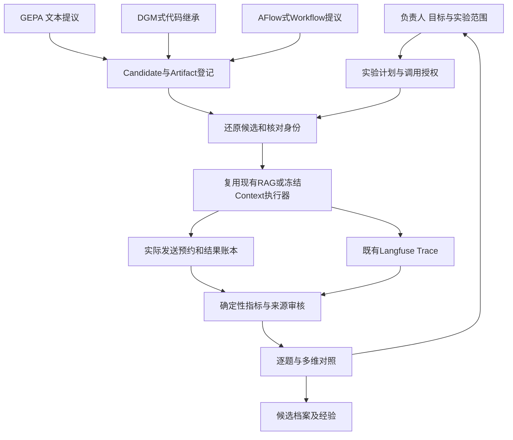

# RSI Core 候选接口提案（供负责人设计审核）

日期：2026-10-30。关联：[RSI-Preparation报告](rsi-preparation-report.md)、[R0研究](rsi-r0-learning-and-implementation-map.md)。本文是接口与职责候选，不是已批准架构或实现；没有创建服务、数据库表、生产API或三个优化器的运行接线。

## 1. 设计约束与已确认前提

当前RAG HEAD为`5e366330e80a3d2e4466139fbed7359f40f949e6`，实际app Hash为`cd386b62b5cdb919e4f2bc67011744a865d679cf86c2dabc19b24bcccca91725`。Langfuse、来源身份、评分函数、真实模型请求记账与历史逐题实验已存在；Core不重复实现这些能力，也不作为正式RAG请求的强制依赖。

本轮实测要求未来设计至少解决三件事：

1. **候选可还原：** DGM式父相对Patch必须有初始版本与完整有序祖先链。Prompt等文本Artifact不需要伪装成Python补丁。
2. **执行可恢复：** GEPA在迭代前保存检查点，审核中断可能重新进入提议；反射异常包装器也会重试。任务结果、反射提议和UNKNOWN必须在外部有稳定身份。
3. **比较可信：** 同一问题不等于同一实验。语料/索引、实际消息、模型参数、执行链、评分口径和来源授权都参与身份；未知指标不能填0，人工和AI标签不能混称人工。

这三项适合由一个小型候选与实验控制边界统一处理；GEPA/DGM/AFlow只是提出或选择候选的可替换策略。

## 2. 总体职责候选



图中三个优化器是未来适配方向，不表示首轮同时接入。正式发布/默认Prompt切换是负责人另行决定的操作，不能藏在`compare`、`archive`或`resume`中。

可以先用不可变文件目录＋小型事务账本，复用现有Langfuse记录；暂不需要独立RSI数据库、Web前端、调度集群或新Agent框架。将来是否集中存储，由实际并发和恢复需求决定。

## 3. 统一数据契约候选

### 3.1 Artifact与候选身份

推荐区分**不可变候选内容身份**与**不断追加的运行状态**，避免一次新评测使artifact_hash变化。以下是SYNTHETIC结构示例，null表示未冻结，不是已产生的真实实验：

```json
{
  "schema_version": "rsi-candidate-proposal/v1",
  "candidate_id": "SYNTHETIC-example-prompt-c01",
  "parent_id": "SYNTHETIC-example-baseline",
  "artifact_type": "PROMPT",
  "artifact_hash": null,
  "patch_or_delta": {
    "kind": "named_text_replacement",
    "component": "generation_instruction",
    "artifact_ref": null,
    "parent_artifact_hash": null
  },
  "base_commit": "5e366330e80a3d2e4466139fbed7359f40f949e6",
  "environment_digest": null,
  "dataset_version": null,
  "evaluation_run_ids": [],
  "metrics": {},
  "status": "NOT_RUN",
  "mutation_reason": {
    "origin": "AI_PROPOSED",
    "failure_refs": [],
    "hypothesis": "Improve support coverage of relevant supplementary facts without dropping answer points"
  }
}
```

null字段要附原因或在冻结计划里补齐，不能用字符串“UNKNOWN”充当真实SHA。可持久化上述便利视图，但核心内容Hash只计算规范化不可变payload；run_ids、metrics、status来自追加事件或带版本的状态快照。涉及Merge时另设`parent_ids`与明确合并语义；首轮单父代不先实现交叉。

|Artifact类型|建议载体|还原方式|本项目接入边界|
|---|---|---|---|
|PROMPT|UTF-8文本/JSON命名组件与模板Hash|父文本＋替换组件，保留实际编译消息Hash|现有生成指令先离线接线；不改生产默认|
|MEMORY|经过审核的经验条目JSONL及纳入/删除Delta|固定条目集合与来源、审核身份|不能把失败Trace、Gold或未审AI总结直接写入会话记忆|
|SKILL|能力说明、版本化资源与既有入口引用|目录内容Hash/小型包与依赖契约|复用已有检索/解析/引用/评测能力，不假称已有运行时装载器|
|WORKFLOW|声明或Python模块、入口、步骤预算|固定模块及允许操作集合|复用LangGraph/ChatService；先表示基线再允许受限变异|
|CODE|base_commit＋有序父相对git diff|逐代核Patch Hash、apply检查与最终tree/content Hash|临时Worktree/Docker；不写正式checkout或共享数据|

Manifest不存API Key或模型凭据。模型绑定使用不含密钥的模型身份、配置Hash和执行器内部引用。授权Cloud正文可以按已批准范围记录；不能因为安全而把所有有用反馈一律Hash，也不能把“文件公开”自动当作已获上传授权。

### 3.2 EvaluationPlan与执行结果

建议计划至少包括：

```text
run_id, candidate_id, parent_run_id(optional), experiment_id
dataset_version, split_manifest_hash, qids, source_group_ids
gold_version, qrel_version, rubric_version, reviewer_policy
code_hash, artifact_hash, environment_digest
source_manifest_hash, index_version, retrieval_config_hash
model_identity, model_parameters_hash, prompt_template_hash
execution_kind: FROZEN_CONTEXT | HTTP_SSE | RETRIEVAL_ONLY | WORKFLOW
requested_stages, capture_policy_ref, budget_grant_ref
comparison_key_version, resource_plan_ref
```

`FROZEN_CONTEXT`可省去实际检索，但需要固定送达成员、顺序、内容与引用映射。没有运行的检索阶段写NOT_RUN，不创造候选列表。“复用缓存”需要输出来源与原run_id，不生成假的Generation。

逐题结果独立保存：

```text
qid, run_id, candidate_id, attempt_id
request_id, provider_request_id?, actual_model?, request_input_sha256
source/index/code/config/prompt/context identity
execution_status, answer_sha256, answer_ref, citations_ref
finish_reason?, input_tokens?, output_tokens?, reasoning_tokens?
latency_scope, elapsed_ms?, price_source?, estimated_cost?, billed_cost?
trace_id?, observation_id?, dataset_item_id?, experiment_item_run_id?
core_correctness, completeness, faithfulness, citation_support, citation_coverage
evidence_by_stage, first_loss_stage?, recovery_stage?, cause_status
reviewer_type, review_ref, reviewed_answer_sha256, rubric_version
```

理由与原始响应可放受限本地引用，Cloud按现有内容策略决定。成本没有价格/账单时为null并附UNKNOWN状态；reasoning属于output子项时不可重复累计。延迟说明是模型HTTP、应用服务、SSE还是评测墙钟，不能混用。

### 3.3 状态不应压成一个枚举

|维度|示例|解释|
|---|---|---|
|任务生命周期|PLANNED、RUNNING、AWAITING_REVIEW、PAUSED_UNKNOWN、FINISHED|控制是否还能继续，非质量分数|
|请求事实|RESERVED、ATTEMPT_STARTED、RETURNED、FAILED、UNKNOWN、NOT_SENT|结果未知不代表失败或免费；发送尝试不证明线上真实收到|
|输出完整性|COMPLETED、EMPTY、TRUNCATED、CANCELLED、UNKNOWN|完整输出也可能答错|
|质量/机制结论|PASS、FAIL、PARTIAL、UNKNOWN、BLOCKED、NOT_RUN、NOT_APPLICABLE|各维度与分母独立，符合项目口径|
|候选档案|REGISTERED、EVALUATED、REJECTED、RETAINED|RETAINED不等于已部署或已批准|

UNKNOWN的作用范围应与请求和运行身份对应。合成实验中对同一运行采用整体暂停是验证策略；未来是否允许继续未发送的独立题，按批准的计划决定，不把一个历史UNKNOWN永久阻断所有无关实验。

## 4. 最小接口候选

下列是Python风格协议草案，**没有在本轮实现**。函数式接口或Protocol均可，首轮不需要RPC服务。

```python
put_artifact(payload, artifact_type, parent_ref=None) -> ArtifactRef
register_candidate(manifest) -> CandidateRef

plan_evaluation(candidate_ref, suite_ref, policy) -> EvaluationPlan
execute_evaluation(plan, grant_ref) -> EvaluationRunRef
resume_evaluation(run_ref, review_decisions=None, grant_ref=None) -> EvaluationRunRef

compare_runs(run_refs, comparison_spec) -> ComparisonReport
cleanup_resources(resource_manifest) -> CleanupReceipt
```

其中`materialize(candidate_ref, isolation_spec) -> WorkspaceRef`是未来Code/Workflow执行器的能力，不要求每个Prompt候选都调用。`read_run`可以先是读取不可变报告文件，无需再建独立查询服务。

|接口|必须保证|优先复用|
|---|---|---|
|put/register|父代存在、内容可回读、Delta/载体与类型匹配；原记录不可静默覆盖|Git、SHA256、现有快照引用；不改旧Gold|
|plan|核对比较身份、选定split和指标、零调用预检；给出可能产生的模型/检索成本|E2固定消息/参数检查及已有冻结Manifest|
|execute|先预约后发送、实际请求与结果持久化、捕获真实Trace；不自动部署|现有Provider记账、Langfuse、HTTP/SSE或冻结生成入口|
|resume|复用已完成输出/提议；已审标签绑定答案Hash；UNKNOWN不重发；只执行获准剩余项|Judge事务预约、E2续未执行策略、官方GEPA run_dir|
|compare|只在可比维度配对；列缺失项及分母，保留PARTIAL/UNKNOWN|evaluation.py现有指标、新旧逐题账本|
|cleanup|只清理登记的本轮临时资源，核对路径/Owner和实际使用；必要证据已导出|项目AGENTS.md收尾规范、现有Docker/Git原生命令|

首轮可只交付Artifact登记、冻结Context执行和比较三条路径；恢复/清理是这条执行路径的必要部分，不必成为复杂调度系统。

### 4.1 Optimizer Adapter如何接入

- **GEPA：** `Candidate`只映射允许变化的命名文本；`evaluate`调用Harness并返回已审数值与真实轨迹；`make_reflective_dataset`只提取授权训练反馈；`ProposalFn`经过相同请求守卫。上游`run_dir`是优化器检查点，Core账本是请求/审核事实，两者互相引用，不互相替代。
- **DGM式候选：** 先恢复父代再编辑，导出父相对Patch，运行前由宿主校验Hash；Archive保存尝试记录，质量接受另由Comparison表达。缺祖先停止该候选恢复。
- **AFlow式候选：** 每个完整Workflow是Artifact；选父、扩展和经验由优化器适配层提出，执行和Gold评价留在隔离Harness。不能直接动态import未经隔离的候选到正式服务。

三个优化器不各自再实现Token预算、私有数据授权、UNKNOWN状态机和指标公式。也不强迫三者共享其内部搜索状态或同一优化算法。

## 5. 请求身份、暂停及恢复契约

### 5.1 现有代码足以复用什么

`llm.py::provider_attempt/provider_generation/_provider_status`负责已有真实调用分类与观测；`e1_judge_calibration.py::reserve/check_unknown_guard/complete`展示SQLite事务预约和不重发历史UNKNOWN的模式；`run_e20_real_pair.py`区分原未知项与从未执行的剩余项。需要复用这些事实，不再创建“仅靠Trace推测发送次数”的账本。

旧Judge表主键为qid且含历史专用白名单，不能直接作为多候选通用表。若未来使用通用账本，应设计独立命名空间/表并保留旧表只读，不把旧授权和旧UNKNOWN状态重置。这里只提出需要，不提前建立数据库迁移。

### 5.2 稳定缓存键候选

任务输出身份建议由以下规范化事实构成：候选内容Hash、完整实际消息Hash、qid及数据版本、来源/索引与检索配置、模型/参数、代码/环境、执行链版本。质量评分另绑定answer/evidence/rubric/reviewer身份，换rubric无需重生成同一答案。

反射提议缓存建议用父ArtifactHash、目标组件、授权训练反馈Hash、反射模型及参数、反射Prompt版本。不要以随机iteration_id当唯一幂等键；如果采样策略明确要求独立再采样，应在计划中分配新的sample_id和预算，而不是隐式重发。

GEPA内部缓存 `(candidate_hash, split, example_id)`解决其自身训练/验证下标隔离，不能替代上面这些实验身份。模型别名不能证明供应商底层revision完全不变，未知部分记录限制。

### 5.3 UNKNOWN与审核恢复

```text
预约发送前事实并落盘
    -> 发送尝试
    -> 已返回：保存原响应、usage、结束原因及输出身份
    -> 结果未知：保留UNKNOWN，不再发同身份请求

已返回但未审
    -> 保存答案与证据引用，等待审核
    -> 审核决策绑定answer hash及rubric
    -> 只回放结果/分数，恢复优化器；不重新生成答案
```

SYNTHETIC实验证明外围守卫可以阻止GEPA包装器的重复实际尝试，但它仍可能吞异常并返回None。因此执行器需要在优化器返回时读取账本决定终态；不能把`None proposal`自动标记为正常完成。UNKNOWN请求的用量及费用保持未知。

## 6. 比较、Gold和数据权限

已有确定性指标优先复用`evaluate_ranking/evaluate_evidence/evidence_transitions/review_metrics/summarize_attempts`，不修改Gold或既有评判标准。

建议Comparison同时报告：计划数、发送尝试数、已返回数、非空数、已审数、PASS/PARTIAL/FAIL/UNKNOWN/NOT_RUN；完整配对数、缺失配对原因；已判分母上的核心结果与计划分母上的确认通过率。选择任何汇总分前先冻结口径，不能为了候选变好而调整分母。

Judge的错误识别Precision/Recall在现有历史数据上未定义，新增8条样本的v3核心人审已确认PASS5/FAIL2/PARTIAL1，但Judge未运行，仍未完成校准；直接复用已确认标签，不重复要求负责人审核。Core不自动把Judge分数视为可靠奖励。人审/受托AI复核均保留来源。先检查最终输出，失败或争议才深入Trace，避免每题全轨迹全人工的无效成本。技术缺失不让用户凭猜测“投票”。

train/val/holdout按来源文档/共享段落分组，候选生成仅接收授权训练反馈，独立留出集不提供给反射/修改容器。Gold可以进入外部评价器，不能进入被测RAG实际Prompt。正文授权、模型外发授权与遥测Cloud授权分别判断，复用现有`trace_schema`策略；不重新发明更严格的答案句式校验。

后续Candidate Pareto视图应保留各格式/类型以及核心、忠实性、引用和成本优势；同时展示评估覆盖，不能以缺失分数的“低成本”赢得比较。只对已经确认的关键安全/身份问题阻断相关操作，非阻断技术债单独报告，不让所有未知项变成全系统失败。

## 7. 隔离、资源与负责人待定事项

已验证Git Worktree和三代Patch恢复，以及ECS两个128MiB/0.5CPU/32PID shell容器。正式Python RAG候选镜像资源NOT_RUN，不能据此承诺同样限额足够。

默认顺序执行、共享只读底座、复用按digest固定的依赖镜像，不每个候选复制大索引、安装依赖或创建数据库。修改容器与评测容器分开；修改容器无Gold、凭据、共享库和Docker socket。宿主验证输出的Patch/Artifact，再将受控候选交给评价侧。临时目录和容器按Owner登记、finally清理，报告前后资源；保留小型Manifest、Patch、结果和必要日志。

建议负责人优先决定：

1. 第一轮仍选生成Prompt，还是另一个已证实失败边界；不同时实施多个机制。
2. 哪些训练反馈允许给反射模型，哪些正文可进入Cloud；直接复用已有授权范围，不扩大私有内容。
3. 来源分组与留出集，以及各评分维度的人工/确定性/Judge职责。
4. 物理发送次数、输入/输出Token预留和UNKNOWN停止范围；新真实调用需独立预算。
5. 文本Artifact与run账本先采用目录文件还是事务存储；不因未来可能并发就现在建完整平台。

**停止点：** 此提案没有认定最终RSI Core架构，没有实现上述接口或接入任何真实优化器。等待负责人审核后再选择一个最小工程切片。
