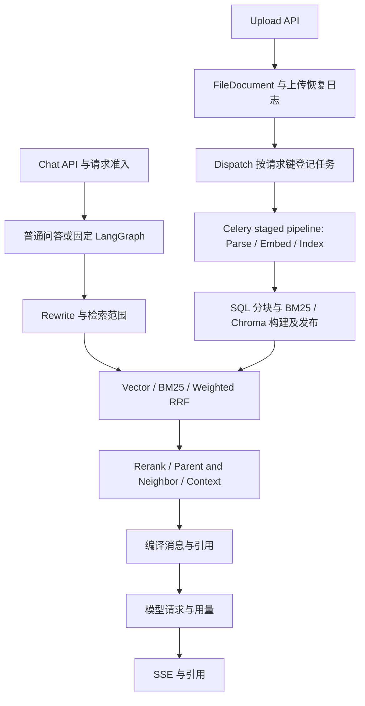
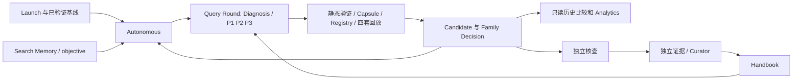

# RSI 第一阶段 F0 全局审查

工作基线为 `codex/rsi-s2@ec33c98ae370237efc9421678f65d789f8c8793d`。启动时 Git 远端同名分支与本地一致，`main` 为 `e242e91a082fe0e28242f172c81bfb25a540dfda`，当前分支的 GitHub PR 查询返回空。工作区有四项既存未跟踪文件或目录，保持原样。F0 源码审查和完整离线回归已完成。

执行来源为 `RSI一阶段方案.zip` 中的 `RSI_第一阶段整体方案包/02_Codex_Goal_Mode_总指令.md`。首次读取完整成功。随后下载目录中原包已不在原路径；补充材料待读取。阶段顺序为 F0 调用链审查、F1 观测、F2 三类候选接入、F3 候选档案和父代、F4 反思搜索和经验、F5 真实验收。扩大代码修改范围、真实模型、受限数据和生产操作各自受授权边界约束。

## 必须分开审查的两份业务树

`D:\RAG knowledge` 的 HEAD 为远端 `main` 所指的 `e242e91a`，存在既有本地改动 `.planning/.active_plan`。与当前 RSI 工作树相比，`backend/app` 有 95 个文件不同，包括分阶段入库、会话、业务检索和生成链路。当前 RSI 副本的业务调用链不能作为正式版证据。正式树从 `git show e242e91a:<path>` 只读追踪。同步大量业务文件或改变工作基线需要单独确认。

## 已追踪的 RSI 工作树内业务入口

| 实际调用 | 输入和输出 | 存储和失败边界 |
| --- | --- | --- |
| `backend/app/api/files.py` 的 `upload_file` | KB ID 与 multipart 文件，经扩展名和大小检查后返回 file ID 和 PENDING | 写上传文件与 `FileDocument`，提交后发 `ingest.uploaded`；此入口不会自动解析 |
| `parse_file_manually` → FastAPI BackgroundTasks → `track_background_task("parse")(process_file_parsing)` | 分块模式、长度、重叠、分隔符、标题级别、自动入库与模型选项；立即返回已触发 | 有有效向量的文件不能手动走破坏性重解析；必须走自动入库入口。后续解析、索引发布和恢复正在追踪 |
| `submit_file_chunks` 或 `vectorize_file_manually` → `track_background_task("index")(process_submitted_chunks)` | 提交分块时限定原 ID 属于当前文件，保留页码、类型、父块、标题与 Token 元数据；手动向量化读取当前分块形成同类 payload | Embedding 先校验数量和向量维度，再写新向量，SQL 事务替换分块与 BM25。SQL 失败时回滚并清理新向量，成功后退役旧 ID。该实现与正式版的分阶段发布不同 |
| `chat_completions` → `ChatService.chat_stream` | 用户消息、检索和模型配置；输出 SSE | 作用域预检后进入普通聊天或 LangGraph。Mode 与模型路由作为实验固定条件。图工作流的工具路径待单独核对 |
| `_chat_stream_normal` → `_retrieve_with_new_service` → `RetrievalService.search` → `batch_rerank` → `expand_context` | 搜索配置和 KB 范围输入，输出结果成员和 metrics；重排空结果为 LOW_RELEVANCE，重排不可确认可标 UNKNOWN；扩展异常退回 seed 并标 UNKNOWN | search 内部先提交 `RetrievalLog`，重排随后发生。聊天层只更新返回 metrics。日志 writer 持久化的 `rerank_count`、`rerank_latency_ms` 和 `rerank_enabled` 为固定默认值，当前应用代码未发现该日志的重排回写路径 |
| `_chat_stream_normal` → `build_chat_context` → 引用与 Grounded Generation | 重排/扩展结果生成 citation 列表；独立 Grounding 可加入受控补充引用。上下文交付 trace 显式区分引用选择与最终模型交付 | 支持 QA trace、来源状态和提取式兜底。仅有 `context.delivery` 的引用选择事件不能证明最终 Prompt 内容。最终发送、用量和 SSE 状态仍需核对 |

现有 `trace_schema.py` 的 `capture_scope` 有 run、attempt、qid 与 dataset version，并按题目及所有来源哈希控制明文捕获。`RetrievalLog`、业务 trace、RSI EventLog 和 Provider usage 需要逐个验证具体关联键。F1 先验证已有路径，再判断如何关联，避免另建观测存储。

正式树也有 `services/retrieval.py` 初始化重排字段、`services/chat.py` 更新内存计数的路径。LangGraph 工具 `retrieval_tool.py` 以检索 attempt ID 发重排、过滤与选择事件；单库和多库召回 API 从 `search` 返回后单独重排。正式树的应用调用方未发现为这些 `RetrievalLog` 行补写重排字段的入口。普通问答的 query 变体和图工作流的重复检索意味着不能按 query 文本回写，F1 要先绑定同一次检索的稳定身份。

## 正式业务树的已核实调用链

| 正式树入口及下游（`e242e91a`） | 关键契约与恢复 |
| --- | --- |
| `api/files.py::upload_file` → `file_uploads.register_upload` / `upload_recovery` | staging 文件与 journal、源摘要和 SQL 文件行分开绑定。重复上传或提交不明发不同事件。保留提交不明确的 journal 供恢复。 |
| `parse_file_manually`、`submit_file_chunks`、`vectorize_file_manually` → `_dispatch` → `dispatch_file_task` → Celery `execute_file_operation` | 按请求键和 payload hash 去重，绑定 generation 并写 receipt、attempt、event。Celery 通知不明仍保留 receipt。执行端 claim / lease / heartbeat 保护任务阶段，不从前端状态推断 Provider 已处理。 |
| `staged_pipeline.execute_stage` → `_parse` / `_embed` / `publish_index_build` | 冻结源、解析和模型绑定，分块阶段与 Embedding 阶段传递带摘要的 checkpoint。`EffectRunner` 使用 effect key、请求和收据关联 VLM/Embedding。恢复只重用可核对结果，不确定状态需要现有 reconcile 流程。 |
| `index_builds.publish_index_build` | 先提交构建归属，再写并回读新向量；单个受 claim 保护的事务替换 SQL 分块、BM25 和活动构建。退役记录保留精确 ID，清理可重试。失败与提交不明分开。 |
| `api/chat.py::chat_completions` → `ChatService.chat_stream` | 请求准入和 SSE 封装在 API 层。会话历史、运行配置与已绑定模型进入本次请求。普通问答和 LangGraph 路径分别在 `_chat_stream_normal`、`_chat_stream_langgraph` 运行。两者 Rewrite 使用现有 LLM 理解能力，失败有原 query 兜底或错误输出。 |
| 普通问答 `_retrieve_with_new_service` → `RetrievalService.search` → `async_batch_rerank` → `expand_context` | Vector 和聚合 BM25 的候选经 `weighted_rrf` 合并，RRF 排序再 min-max；记录候选变化和排名。重排及父块/邻接扩展后才进入引用和最终上下文。当前正式树也在重排前提交 `RetrievalLog`。 |
| 普通问答 `build_chat_context` → `prepare_grounded_request` → `generate_grounded_candidate` 或 `stream_grounded_candidate` | 引用构造、证据扩展/打包与 Provider 消息分层。在真正调用前记录最终消息捕获、模型和已交付 evidence IDs；Provider 回执附已观测用量和 finish 状态。未观测用量保持未知。 |
| LangGraph `AgentWorkflow.run_tools` → `process_tool_output` → 工作流生成节点 | 工具返回消息、检索 attempt ID 和来源注册表，由 Agent 路径组装与裁剪实际消息，再调用 Provider。Agent Workflow、模型路由及可选重试仅作为固定条件，F0 不验证线上配置。 |

正式树已有文件入库测试 `test_staged_pipeline.py`、`test_index_builds.py`、`test_ingest_settings_wiring.py`，检索/上下文/流式证据相关测试有 `test_retrieval_outcomes.py`、`test_async_rerank.py`、`test_retrieval_tool_status.py`、`test_agent_direct_first_retrieval.py`、`test_trace_usage_authority.py`、`test_dynamic_routing_chat.py`。这些是正式版本的源码覆盖清单，F0 的 RSI 回归不等于在当前运行正式树全部测试。

- 入库恢复按 `<UPLOAD_DIR>/.upload-recovery/<file_id>.json` 及任务 `<task_id>/<content-digest>.json` 核对。内部 `UNKNOWN` 对用户投影可能显示为 `RETRY_WAIT`，因此故障归因使用内部 receipt、attempt、effect 和 event。后台 `file_task_recovery.scan_once` 检查过期 claim，调用 reconcile 后重新发布到期任务。
- 问答直聊路径经 `route_direct_history_generation`，不执行检索；无结果模型兜底仅在干净的 NO_RESULTS 下运行；提取式兜底无需最终模型。Grounded 缓冲与流式有不同结束证据。捕获的 `grounded.request.sent` 在 Provider 实际调用前发出，只有返回的 Provider ID、用量、响应状态及 SSE 终止才分别证明对应阶段。SSE done 无法证明回答正确。
- 单库 recall 重排失败可保留原命中，多库 recall 的重排异常走外层错误处理。Agent 工具返回的 `context.delivery` 标为 `tool_response`，不能当作最终 Provider 证据。search 发生 UNKNOWN 时可能在日志写入前抛出，F1 不以 SQL 行存在作为运行分母。

## 已定位的测试资格边界

`docs/rsi-v24-s34-final-decision.zh.md` 记录 DEV20-R2 的准入为 0/20，真实 A/A 为 NOT_RUN，221 个成员的真实 Seed/Nonseed 为 UNKNOWN。`docs/rsi-r1-e1c-readiness.md` 记录六题只能用于开发，且没有独立留出准备。该证据针对各自方案与版本，需要结合当前冻结集和评测来源重新审核。DEV 审核授权不能替代独立 holdout 资格。

## RSI 调用链与存储

| 调用路径 | 身份、制品与恢复 | 已有验证入口 |
| --- | --- | --- |
| `autonomous.run` → `run_query_round` → `workflow.execute_round` → `OpenAIRoles.call` | 启动身份、公共投影和角色选择绑定；Diagnosis/P1/P2/P3 只见允许上下文。请求前账本用稳定 request key，输入回执关联 Prompt hash/角色/目标。收据状态不明时自主循环停止；无重复发送证明时保持未知。 | `test_autonomy_boundary.py`、`test_openai_roles.py`、`test_invocation_observability.py` |
| `query_workflow` → Patch/invariant probe → `QueryRegistry.put` → `holdout.replay_artifacts` → `adjudicate_round` | 受限 Worker、父 ID、有效 config hash，四套 fixture hash，输出每套 Decision、主 Decision、Family Decision、Round 和完成记录。候选在 Capsule 中验证、运行，全部终端结果才形成完整家族裁决。`resume_query_round` 复核既有产物和身份，已完成回放不重跑。 | `tests/test_query_workflow.py`、`test_execution_evidence.py`、`test_capsule_shutdown.py` |
| `experiment.Experiment`、`holdout.verify_sealed`、`query_verification.verify_sealed` | 通用与 Query 路径各有资格证据，训练采纳和 sealed 验证分别记录。执行状态由 `StageJournal` 使用输入身份及 intent/receipt 协调；旧完成结果仍需数据与运行身份匹配。Promotion 更新模拟指针并保留授权/回滚摘要。 | `test_lineage.py`、`test_launch_baseline.py`、`test_query_stress.py`、`test_handbook_and_promotion.py` |
| `autonomous.remember_round` / `project_search_memory`，以及 `query_learning.curate_verified_candidate` → `Handbook` | Search Memory 保存原始历史、指纹和轮次；公开投影有上限。Handbook 以内容哈希存 entry 和 evidence，EventLog 恢复状态；经验只基于独立验证回执，投影按 Profile 与兼容性筛选。Curator/Meta 使用完成投影。 | `test_objective_memory.py`、`test_objective_handbook.py`、`test_query_learning_bridge.py` |
| `objective_comparison.compare_historical`、`analytics.projections.project_sources` → report | 只读读取绑定 SHA-256 的 Round 与事件，区分测量、执行、历史采纳和新目标排名。Token 汇总复用账本和请求身份。最终回答用量在 Context Selection 回放缺测。 | `test_objective_comparison.py`、`test_objectives.py` 及 Analytics 回归 |
| `lineage.ParentPool` → `admit/select` | `parents.sqlite` 记录准入，真实模式校验/recompute 关联资格收据，`select` 现有固定轴与种子机制；通用 Experiment/Holdout 接准入。当前 `autonomous.run` 仍读取 `current_parent_id`，仅在新训练采纳后转为新父代，没有运行 `ParentPool.select`。 | `test_parent_selection_m1a1.py`、`test_lineage.py`。现有算法测试不能证明自主入口已接多分支。 |

### 旧管线能力与差距

| 机制 | 实际入口及制品 | 当前缺口 |
| --- | --- | --- |
| Prompt / Memory Addendum | `rsi_quality_loop.execute_quality_loop` → Registry `derive/materialize/verify_manifest` → `rsi_quality_execute.execute_artifact`；锁定 cases、evaluation、产品源指纹、父代和 addendum，保存 worker 回执、评分、用量/时延与 baseline index；`reuse_baseline/recover_baseline` 读取已有结果 | 当前 RSI 工作树缺少 `scripts/rsi_quality_worker.py`，正式树有该入口。旧适配器要求指定的 `product_root` 内存在该脚本，不能直接用当前 RSI 树当产品源码。Registry 允许旧 `workflow` scope，第一阶段不得用于优化。需要以隔离、冻结的可用产品树核对最终 Provider 消息工件。 |
| 参数与 Worker Patch | `rsi_candidates.derive` 保存规范化 config、Worker 和已登记来源；`materialize/verify_arm_sources` 验证父代及两臂摘要。R0/R1 `experiments/` 有合成和工程 fixture；CLI 有 config 与 patch 互斥检查。正式树独立 Worker 的 `search_config` 已白名单校验 `top_k` 1–100、`context_window` 0–2、阈值与两路权重 0–1；仅 fulltext/hybrid，hybrid 两权重必须正数且要求 Embedding 请求上限，rerank 固定关闭。 | 旧适配器把 retrieval dict 转发给实际 Worker，自身没有对应候选派生白名单。F2 应复用 Worker 校验并向前绑定可修改项和有效配置 hash；不能把 config 哈希当作白名单，也不能自动扩展到已禁用 rerank 参数。 |
| GEPA、DGM、AFlow | `scripts/rsi_preparation/gepa_synthetic.py` 运行已固定源码 GEPA 的合成优化；`git_patch_synthetic.py` 加载 DGM 的 `choose_selfimproves/update_archive` 函数体做合成继承；`aflow_synthetic.py` 复用有限工具体做合成搜索。当前 ParentPool 提供本地 Pareto 原语。 | 合成适配不证明真实模型或正式 RAG 优化。阶段应复用既有角色、回放和引擎接缝，禁止自动放开 Agent Workflow。 |

### 分阶段初步决策

| 阶段 | 已在代码中找到的能力 | 待验证或决策 |
| --- | --- | --- |
| F1 | 业务 trace 与捕获、RSI 事件/请求账本、Round 逐题测量 | 版本绑定、稳定身份桥接、重排回写、基线与候选口径，独立检查 SWE/数据资格。 |
| F2 | Prompt 旧 Registry、选择器 config、Patch/AST/Capsule | 完整消息冻存、有效参数白名单及运行消费、Context Selection 范围内 Issue 到 A/B 的隔离证据。扩大代码 scope 必须授权。 |
| F3 | S2.1.1 目标比较、资格门、已有 ParentPool | 合格多分支接到实际入口，比较最近赢家、全体合格、Pareto 及多分支的只读/合成策略。TRADEOFF 保留与可执行父代准入分别处理。 |
| F4 | S1/S2 Search Memory、Handbook、相对风险与目标过滤 | 控制有/无经验输入，使用 Diff 与实际请求统计证明未重复和质量。 |
| F5 | 已保存的开发与历史证据 | 真实三类实验需新授权。独立数据、Gold/Qrel、Rubric、外发策略需在启动前核证。 |

### 存储与连接键

| 存储 | 已存在的主键和粒度 | F1 边界 |
| --- | --- | --- |
| 业务 SQL、Chroma 与 staged task artifacts | KB/file/chunk、generation/build、task/attempt/effect，记录来源、检查点与构建 | 实验复用只读快照和冻结引用，保留正式库隔离。 |
| RetrievalLog | 在 search 末尾单次提交，UUID 局部生成；缺失时不从 trace 倒推这行一定写过 | search 未向调用者返回该 UUID。重排指标在不同调用方产生；既有日志没有通用后续回写接缝。 |
| 业务 Trace 与 Provider 回执 | `run_id/attempt_id/qid/dataset_version`、`trace_id/span_id/stage_attempt_id`；`routing_trace_bridge` 携带这些键与 request hash、Provider request ID、用量及响应状态。运行身份和 content capture 权限分开 | 该桥是可关闭和 fail-open 的 BASIC 元数据路径。Prometheus 用量按阶段聚合，无法逐请求对账。没有启用或缺结束事件时标 UNKNOWN；不能由结束流猜 Provider 用量。 |
| 质量 Worker | `job.json`、`product/results.json`、逐题 `record-*.json`、`worker.json`、case ID / repeat ID。正式树的独立质量 Worker 在代理实际 Provider 调用前记录 `calls/*-request.json` 的 factory request、actual request 与实际 UTF-8 wire。 | 优先对已有实际请求消息计算哈希并绑定候选/题目/尝试；聚合投影里的字符数不能替代 Prompt 哈希。仅具备 Worker 源码不证明每个历史候选都存在完整的调用文件。 |
| RSI Registry / Round / EventLog / Budget | candidate、parent、proposal、round、request key/hash、逐题和执行证据 | 优先读现有账本和受限制品；产品请求和提案角色请求的标识空间需要显式区分。 |
| Search Memory / Handbook / Objective / Analytics | 搜索历史、entry 哈希、范围/效果、冻结 Profile、源摘要与只读报告 | 保留来源及比较口径。公共报告不写 Gold、受限制品正文或 Provider 凭据。 |

既有 `docs/rsi-qa300-selected20-readiness.zh.md` 证实历史派生 DEV/FINAL 题号各 20 项，但旧评分用于预分层，旧历史前缀也曾包含部分拟留出题。历史捕获 citation 无法证明原始预选择成员池完整。新阶段需要独立的来源家族、数据曝光及必要事实清单；在核查前保持 BLOCKED，不能用独立 Qrel 缺失时的 0 值代替 NDCG。

已有真实历史角色请求与 Context Selection 回放，但缺少连贯的正式业务链对照。历史预算审查 `docs/evidence/token-budget-audit.json` 的一次轮次有六个已执行角色请求，三个提案耗尽各自 4096 输出 Token 而无可见补丁，属于实际用量与失败证据；新候选质量仍未测量。S3.3 的 668 事件快照和之后 680 事件快照不是同一时点，也不能直接当作本阶段实时余额。F5 授权对象应基于届时的冻结 A/B、已准入样本、请求上限、输入/输出 Token 估算和独立评分计划。

本阶段未调用模型、未部署、未改业务代码、未读独立留出正文。

## F0 交付回执

完整离线回归单次 862 项通过，失败、错误、跳过均为 0，退出码为 0，耗时 467.40 秒。逐项比对 S2.1.1 JUnit，862 个测试身份完全一致。完整 JUnit、命令、日志和退出码见 `var/rsi-first-stage/f0/full/`，哈希和分母核对见 `var/rsi-first-stage/f0/verification-summary.json`，阶段 Diff 见同目录 `f0.diff`。本阶段仅增加审查报告，回归验证范围是 RSI 的既有全量离线套件。

复用现有 Git 对象、Python 环境和离线 fixture。没有创建容器、复制语料、修改数据库或删除资料。pytest 临时目录 `C:\Users\22088\AppData\Local\Temp\rsif0-be428` 大小 141.13 MiB，按用户约定留给用户自行清理。测试开始及结束时 C 盘可用空间约 20.16 / 19.89 GiB，D 盘均约 98.64 GiB，整盘快照包含同期活动。

F1 先从当前隔离副本修复已确认的日志接缝，再使用现有 Trace、候选和 Provider 收据构建逐题身份桥。正式树标识始终单独记录。真实模型、受限数据外发、生产操作和扩大代码候选白名单保持各自的授权门。
