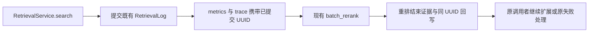

# RSI 第一阶段 F1 实验观测

F0 工程审查提交为 `8c9671a9`，L1–L3 和 Git 交付补充约束见 [第一阶段授权与 Git 交付](rsi-first-stage-governance.zh.md)。本阶段在 RSI 工作树修复日志观测并复用已有实验制品。Rerank、检索或工作流的候选修改权限沿用治理清单。

## RetrievalLog 接缝

普通 Chat、Agent 检索工具、单库 recall 和多库 recall 使用同一接缝，保持原调用参数、重排顺序与异常行为。重排状态与持久化结果单独记录。可确认的空输出是 0，未确认结果无可用数量。数量只描述过滤和 top K 之后返回的成员，不能证明所有上游候选都得到了分数。SQL 中既有重排字段由同一检索 UUID 精确回写；历史字段以及重排前 final count、results summary 的原语义保留。没有 log UUID 时仍可保留 trace，不能以查询文本去匹配另一条日志。若存储失败，保留观察状态供诊断。

## 逐题身份与证据策略

使用明确提供且哈希绑定的源制品。质量 Worker 的运行、候选、题目、repeat、attempt 和 request 分别保留。请求序号只在该运行的请求种类命名空间内有意义，Embedding 和生成请求不能互相去重。首轮和重试分开，最终聚合不重复累计。Context Selection 的 Round、Replay、Capsule 进程和 Provider 请求是不同身份。结构回放捕获的模拟请求数量不是实际的付费请求。

正式代码快照 `e242e91a` 与 11 月 6 日旧实验执行来源不同。历史投影只报告制品支持的代码、配置、评测与消息身份。阶段未观测、来源互相矛盾或旧文件没有标识时保留 UNKNOWN；NOT_RUN 需要明确的执行证据。实际发送的 Prompt 哈希需要真实消息边界，无法用长度、抓取摘要或外层请求文件的哈希替代。业务 trace 与最终回答评分仍分开，已执行状态和质量分数含义不同。

`rsik.analytics.case_observations` 提供两个宿主入口。旧质量 Worker 入口验证 worker 与相邻 product results 的 SHA、当前 job 与候选 artifact 的规范化 SHA，再投影每题和每次尝试。同一请求的完成和用量按已有记录处理，缺少结果维持训练可读的 UNKNOWN。Context Selection 入口将现有 Round 的匿名评测状态与显式选定的 Replay manifest/results 对齐，检验评测版本、候选/父代版本、qid 与上游快照身份。两条路径复用已有文件，由调用方提供明确源引用，不扫描目录猜测制品或新建账本。

| 只读复核 | 观测行 | 本次证据边界 |
| --- | ---: | --- |
| 两个旧 Prompt 候选 | 各 6 题、12 次实际归档尝试 | 尝试身份、上下文长度、产品尝试耗时可绑定。当前只读投影未绑定回答评分，Prompt 精确哈希和可验证产品源码身份保留 UNKNOWN。 |
| matched-k3 P1、P2 | 各 20 题、40 条 A/B 观测 | 有冻结的上下文字符数、事实与来源证据；当前输入缺少逐臂 attempt 收据，完整身份仍 UNKNOWN。真实问答在这类回放中为 NOT_RUN。 |

历史复核命令见 `var/rsi-first-stage/f1/replay-history.py`，输入选择、摘要和派生制品在同目录。未修改旧 Round、Evaluation 或工作产物。本阶段没有真实模型调用。

## 验收

单次完整离线回归 926 项通过，失败、错误和跳过均为 0，退出码 0，耗时 409.40 秒。逐项匹配 F0 的 862 项与业务定向回归 53 项，另有逐题投影 11 项。业务定向回归覆盖四个重排入口、同查询多日志、合法的零结果、未确认及数据库更新失败。全量测试的 24 条警告来自既有依赖或时间 API 的弃用提示。原始 JUnit、执行命令、日志、退出码与 SHA-256 总表保存于 `var/rsi-first-stage/f1/`。本次新模型调用与新增实际 Token 消耗均为零。

复用已有依赖、冻结制品和测试 fixture。未创建容器、复制索引或语料，也未删除用户文件。测试临时目录 `C:\Users\22088\AppData\Local\Temp\rsif1-0f567` 共 141.21 MiB，按用户约定保留供手动清理。C 盘可用空间快照约为 19.72 / 19.45 GiB，D 盘均约为 98.64 GiB。

下一阶段使用正式版本现有产品 Worker 及离线 Provider 替身，建立 Prompt 实际编译、白名单参数实际消费以及 Context Selection 受限修改的回执。F1 已覆盖手头可验证的观测缺口，正式业务完整链路的 TTFT、逐阶段事实流及候选答案收益仍需合格实验提供证据。
