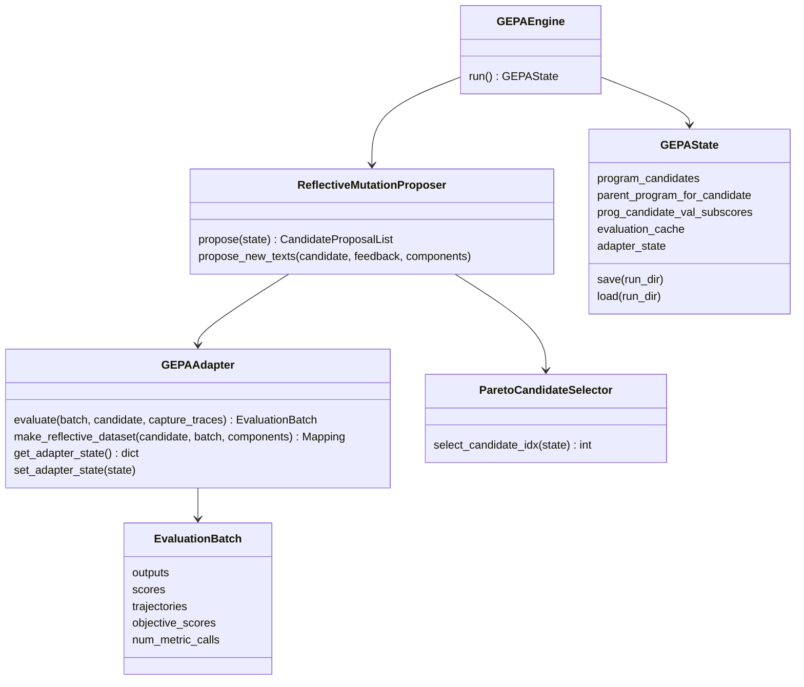
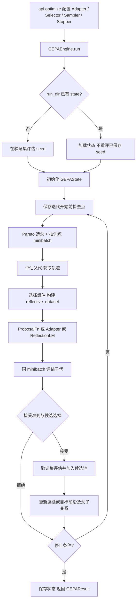
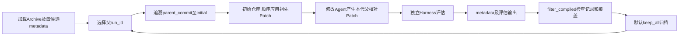

# RSI-Preparation：源码研究与工程验证报告

日期：2026-10-30，Asia/Shanghai。结论口径：**论文事实、固定源码事实、SYNTHETIC 实测、工程建议**分别标记。本文不是 RSI Core 实现或正式上线验收。

## 1. 版本、范围与总评

|对象|本轮固定身份|
|---|---|
|RAG 分支|`codex/pdf-parser-migration`|
|RAG HEAD|`5e366330e80a3d2e4466139fbed7359f40f949e6`|
|实际 app Hash|`cd386b62b5cdb919e4f2bc67011744a865d679cf86c2dabc19b24bcccca91725`，按现有 `observability.code_fingerprint` 算法重算|
|GEPA|`1a435101551629de917a37110b29805268a98bfd`，源码包版本0.1.4|
|DGM|`a565fd2d1dca504ef5104a7cc0f3bdc4ab9b4fd2`|
|AFlow|`3f457218fc716093fe53f6df8a5d5e6379d66346`|

复用 R0 官方浅克隆和已下载资料，GEPA 仅补齐原固定 Commit 的缺失源文件。未安装 GEPA、DGM、AFlow；GEPA 通过源码正常 `import gepa` 和官方 `optimize` 执行。没有更新 RAG 环境依赖。当前项目根未发现 `progress.md`、`docs/adr/`；以根 AGENTS.md、R0/E1/E2 报告及 `.planning/2026-10-30-rsi-preparation/` 为任务依据。启动前已有 AGENTS.md 和 `.planning/.active_plan` 修改，未覆盖。

|任务|结果|边界|
|---|---|---|
|A：GEPA 深度研究、替身与恢复|PASS（SYNTHETIC）|官方引擎已执行；人工审核及 UNKNOWN 需要外围持久账本，不能直接等同原生支持|
|B：DGM 继承及多代恢复|PASS（SYNTHETIC）|三代父相对 Patch、临时 Worktree、官方选父/路径辅助函数；未运行完整 DGM|
|C：AFlow 工作流搜索模拟|PASS（SYNTHETIC）|执行未修改的官方工具类 AST；工作流、变异、评分均为替身，完整 Optimizer NOT_RUN|
|D：RAG 接入边界|PASS（静态已审范围）|未修改业务代码，最小接口只是提案|
|E：Evaluation Harness|PARTIAL|可信记录和部分确定性指标可复用；可靠自动质量奖励、独立留出集仍不足|
|F：ECS 隔离|PASS（SYNTHETIC）|两个短生命周期容器，限制与只读挂载有效，已清理；不代表完整 Python RAG 镜像性能|

本轮外部模型调用 **0**，Langfuse 查询/写入 **0**，生产数据库/Redis/凭据访问 **0**（隔离实验）。E 部分读取已有源码、公开报告，不重新查询 Cloud 或重跑旧评测。无正式服务切换，无提交、推送、合并。

## 2. A：GEPA 深度研究

### 2.1 核心类关系与完整调用链

以下路径均相对固定 GEPA 仓库根；可从[固定源码入口](https://github.com/gepa-ai/gepa/tree/1a435101551629de917a37110b29805268a98bfd)按路径核查。本轮以本地 Git 对象与源码为准，浏览器无法取回该 Commit 页面不影响固定源码读取。





**源码定位：** `api.py::optimize`；`core/engine.py::GEPAEngine.run/_run_reflective_batch/_run_full_eval_and_add/_add_evaluated_program`；`proposer/reflective_mutation/reflective_mutation.py::ReflectiveMutationProposer.propose`。不是每个提议都会进入池：默认先过 minibatch 严格改进，再做验证。多任务提议、去重、选择策略与可选 Merge 是当前源码扩展，试点不需要全部启用。

### 2.2 数据结构与关键函数输入输出

|符号 / 位置|输入|输出 / 约束|
|---|---|---|
|`Candidate`，`core/adapter.py`|命名文本组件|`dict[str,str]`；不是代码补丁、完整 RAG 实例或候选 Manifest|
|`EvaluationBatch`，同上|逐样本执行结果|`outputs:list`、`scores:list[float]`；可选 `trajectories`、`objective_scores`、`num_metric_calls`；序列须对齐|
|`GEPAAdapter.evaluate`|数据批、Candidate、是否捕获轨迹|EvaluationBatch；同步协议，异步 RAG 需在隔离执行器边界桥接，不能在已有事件循环随意 `asyncio.run`|
|`GEPAAdapter.make_reflective_dataset`|Candidate、EvaluationBatch、待改组件|组件名→小型反馈样本列表；由项目选择可授权的真实 Trace 反馈|
|`ProposalFn.__call__`|父 Candidate、反馈 Mapping、组件列表，可选 `metadata`|仅返回被修改组件的新文本；metadata 有 iteration_id/parent_iteration_id，不是稳定模型请求身份|
|`ReflectiveMutationProposer.propose_new_texts`|父、反馈、组件|内部为新文本、反射Prompt、原输出、反射metadata四元组；项目 ProposalFn 不直接返回这四元组|
|`ParetoCandidateSelector.select_candidate_idx`|GEPAState|父候选下标，读取前沿和 tracked scores|
|`GEPAState`，`core/state.py`|种子及验证结果|候选数组、父下标列表、逐题分数、目标分数、前沿、迭代与评估预算、输出缓存、Adapter状态|
|`GEPAState.save/load`|run_dir；可选 cloudpickle / agent state|`gepa_state.bin`、`run_log.json`等；pickle仅可加载自己信任的文件|
|`optimize`，`api.py`|seed、trainset、显式valset、Adapter、反射或ProposalFn、策略、预算、run_dir|GEPAResult；可取得池、分数和最优候选；返回不等于项目自动批准|

源码中 `adapter.propose_new_texts` 的“未提供”值需要明确为 `None`；本轮最小 Adapter 采用类属性 `propose_new_texts=None`。三参数旧 ProposalFn 与支持 metadata 的新签名均有兼容接线。可选 `get_adapter_state/set_adapter_state` 使用 duck typing；需要返回独立字典，不能依赖进程内对象继续存在。

`GEPAState` 的关键字段包括：

```text
program_candidates: list[dict[str,str]]
parent_program_for_candidate: list[list[int|None]]
prog_candidate_val_subscores: list[dict[example_id,float]]
prog_candidate_objective_scores: list[dict[objective,float]]
program_at_pareto_front_valset: dict[example_id,set[candidate_idx]]
evaluation_cache: EvaluationCache|None
adapter_state: dict
total_num_evals, num_full_ds_evals, i, full_program_trace
```

`EvaluationCache` 的键为 `(candidate_hash, split, example_id)`。本版本已区分 train/val，历史不含 split 的条目加载时清除；**仍未自动包含本项目的语料、索引、模型、Prompt编译方式与评分版本**。不能在换题集后沿用原 run_dir 并相信下标就是同一题。`initialize_gepa_state`会检查 frontier_type，不能替代完整实验身份校验。

### 2.3 算法伪代码与 Pareto 边界

```text
加载已有池，或评估种子验证集并初始化池
while 预算与停止条件允许:
    保存迭代前检查点
    从现有前沿选父代，抽取训练 minibatch
    执行父代，得到逐题分数和真实轨迹
    用组件相关失败轨迹构造反射反馈
    生成少量组件文本候选
    在相同 minibatch 执行候选
    按接受/选择策略保留提议
    对接受者评估验证集，更新候选池和前沿
保存状态，返回结果；项目另行审查是否采用
```

**论文事实：** GEPA 用自然语言反思、局部修改和逐实例前沿保留不同样本上的优秀候选，而不是只从最高平均分的一个父代出发。[GEPA 原论文](https://arxiv.org/html/2507.19457v1)

**源码事实：** `strategies/candidate_selector.py::ParetoCandidateSelector`调用`gepa_utils.select_program_candidate_from_pareto_front`；当前支持 instance/objective/hybrid/cartesian 前沿。`strategies/acceptance.py::StrictImprovementAcceptance`默认比较子/父 minibatch 分数总和。多目标前沿不取消这个标量接受门；标量选择不当仍会在进池前丢掉有局部价值的候选。项目应保存全部提议的身份、拒绝理由与实际评估覆盖，不把“进入Archive”直接等同“优于基线”。

### 2.4 人工暂停、UNKNOWN 与恢复：实测重点

脚本：[gepa_synthetic.py](../scripts/rsi_preparation/gepa_synthetic.py)。调用真实固定版本 `optimize`，任务执行、反射提议、反馈全部为 SYNTHETIC。原生观察版 r2，以及使用最终同一脚本复核的 r4-native，与带外围守卫版 r3 分开保存。

|场景|已验证行为|解释|
|---|---|---|
|正常完成后恢复|池2个；合成执行8→8；已保存seed不重评|原生 run_dir 恢复有效|
|子代输出落盘后等待人工审核|首阶段执行5次、池1个；审核后最终8次、池2个；复用3条结果|GEPA不是原生人工任务队列；独立结果账本补齐检查点前后缺口|
|原生恢复的反射提议|r2提议实际执行1→2|恢复从迭代前检查点继续，反射可能重发|
|提议缓存后的审核恢复|r3提议函数进入2次、实际合成提议只执行1次、缓存命中1次|稳定缓存键不能采用每次变化的 iteration_id|
|任务结果UNKNOWN|r3保留1条UNKNOWN；执行5→5、提议1→1，池仍1个|入口检查未知账本，暂停比较；不把UNKNOWN填0或NaN|
|另起Python进程恢复|3个场景新增任务/提议执行均0；UNKNOWN场景为BLOCKED_UNKNOWN|使用磁盘检查点/账本；不依赖原进程内对象|

还有一个独立的实测风险，脚本：[reflection_unknown_synthetic.py](../scripts/rsi_preparation/reflection_unknown_synthetic.py)。官方 `ReflectiveMutationProposer._propose_texts_batch_safe`捕获任意 `Exception`，先记录批量失败，再逐任务执行 `propose_new_texts`，失败则返回`[None]`。合成超时UNKNOWN：**无守卫尝试2次，有持久化守卫尝试1次**；两者最终都返回`[None]`。因此：

1. 不能只设置 `raise_on_exception=True`就断言反射UNKNOWN会向外传播。
2. 需要在每次反射发送前核对持久化请求状态，并在本轮返回后检查UNKNOWN；UNKNOWN不能伪装为普通“无候选”。
3. 任务调用缓存与反射提议缓存均需存在；模型SDK重试和GEPA包装器重试是两层不同机制。
4. 检查点在迭代开始前保存，未完成迭代的结果不能只放在Adapter内存或等下个检查点再写。
5. 本轮替身JSON账本证明流程可行，**并发/崩溃原子性不是生产验收**。现有Judge的SQLite预约可研究复用，不要照搬JSON到真实付费执行器。

暂停应是运行控制状态，质量仍是未审/UNKNOWN；审核完成才交给GEPA数值分数。原生`EvaluationBatch.scores`没有UNKNOWN/人工待审枚举。可用`objective_scores`保存多维已知分数，但不能把不足的Gold强行变成确定归因。

### 2.5 与RAG适配、不能直接照搬的部分

适配点是自定义 `GEPAAdapter` 和受控 `ProposalFn`：执行已冻结Context的现有生成入口、返回已有评分账本和授权反馈，不重写RAG。先优化单个生成指令；查询改写/Agent提示是后续独立组件。当前`generic_rag_adapter`会建立其自己的Pipeline/evaluator，不能直接替换项目真实检索和模型记账。

不能直接照搬：反射异常重试、缓存身份不足、同步接口、未经校准Judge、数值分数无法直接表达未知、按指标调用数而非物理模型发送次数停止。还需独立限制迭代/时间：缓存命中使新评估调用数为0时，单靠`max_metric_calls`不一定停止无进展循环。对随机过程的逐步完全复现未验证；保存候选/请求事实与保证最终业务可复现，不等于已实现优化器随机流的逐指令恢复。

## 3. B：DGM 深度研究与Patch恢复

### 3.1 父代、谱系与Archive

源码：[固定 DGM](https://github.com/jennyzzt/dgm/tree/a565fd2d1dca504ef5104a7cc0f3bdc4ab9b4fd2)。核心 `DGM_outer.py::initialize_run/choose_selfimproves/filter_compiled/update_archive/main`。



`parent_commit`在这些metadata里主要指DGM候选run ID，不一定是真实Git SHA。建议保留原名解释，项目Manifest使用`parent_id`和`base_commit`分别表达。DGM历史`metadata.json`含parent_commit、entry/problem_statement、model_patch_exists/notempty、overall_performance等；全局逐代记录含generation、archive、尝试ID。

CLI默认选父`score_child_prop`：权重正比 `sigmoid(10*(accuracy-.5))/(1+children_count)`，再归一化，有放回抽样。它兼顾分数与少被扩展的父代，不是每代固定最高分。**固定源码`method='best'`按分数升序排序后取前项，本轮实际选中了最低分initial**；这与其名字/注释不一致，不能直接作为项目“选择最佳”实现。

默认`keep_all`把通过前置有效性筛选的候选加入Archive，不仅保存超过父代者；`keep_better`按初始表现与噪声余量比较，不能误写为严格超过父代。`is_compiled_self_improve`检查评测字段、非空Patch任务、覆盖量，不是独立安全审查/编译证明。[DGM 论文](https://arxiv.org/html/2505.22954v1)的开放式归档思想可借鉴，但不替代本项目验收规则。

### 3.2 Patch继承和Docker生命周期

`utils/evo_utils.py::get_model_patch_paths`从父候选反向读metadata，找到每代`model_patch.diff`后翻转顺序。**缺Patch会打印警告继续**；本轮删除合成c2后实际只返回c1/c3。项目恢复器应报告缺失并停止恢复该候选，不能用错误祖先状态继续评测。

`self_improve_step.py::self_improve`创建容器、应用祖先补丁、提交恢复后的父状态、再次pip安装requirements，然后运行`coding_agent.py::main`。`coding_agent`使用实际恢复父代Git SHA作为`base_commit`，`utils/git_utils.diff_versus_commit`导出本代增量。因此完整恢复需要**初始Git身份＋有序全部祖先Delta＋本代Delta**，不能把最后一个Patch单独应用到初始仓库。

生命周期：`utils/docker_utils.py::build_dgm_container`复用或构建镜像并`containers.run` →复制源码/恢复父代 →修改和导出 →`cleanup_container`停止并删除 →评测Harness读取补丁链。正常路径有清理，但各异常/提前返回并非统一finally；例如读取model_patch失败返回处没有同等清理保证。

不能照搬：容器默认未设CPU/内存/PID限制；默认网络和权限不适合不可信候选；修改容器接收模型/云凭据；重复pip安装；输出和解析成功不证明候选安全。项目需由宿主受控发送模型请求，修改容器不接触密钥、Gold、共享数据库或Docker socket。Docker隔离也不等同独立虚拟机安全边界。

### 3.3 三代实际恢复验证

脚本：[git_patch_synthetic.py](../scripts/rsi_preparation/git_patch_synthetic.py)。只在系统临时目录创建小型合成Git仓库，不在RAG仓库创建实验Worktree或提交。

- 产生c1→c2→c3三代父相对`model_patch.diff`，每代记录父ID、Git父/子SHA和Patch SHA256。
- 调用未修改的官方`get_model_patch_paths`函数体获取顺序；从同一base的另一临时Worktree按顺序`git apply --check`、`git apply --index`。
- 最终Git tree一致：`7760e2692ff1f40bbb0f96c25dac75c338caf845`；文件SHA256为`4a1cd65413009d815de9c77574aa7abbf9f1689fe9fced3352ddc7a0996dfaec`。
- 乱序直接应用c3的check退出1，预期失败；缺中代Patch的官方警告行为被记录。最终恢复路径退出0。
- 两个Worktree均明确移除，临时仓库随后自动清理。保留仅几百字节Patch、metadata、命令与Hash。

测试调用官方辅助函数时采用AST提取原函数体，提供标准库文件读取；未导入DGM的Provider/Docker整套依赖。选父测试走其受支持的polyglot分支。完整自改代码Agent、SWE/Polyglot真实评测为NOT_RUN。

## 4. C：AFlow深度研究与工作流模拟

源码：[固定 AFlow](https://github.com/FoundationAgents/AFlow/tree/3f457218fc716093fe53f6df8a5d5e6379d66346)。`scripts/optimizer.py::Optimizer`、`scripts/operators.py::Operator`、`scripts/optimizer_utils/{data_utils,graph_utils,experience_utils,evaluation_utils}.py`、`workspace/HotpotQA/workflows/round_1/graph.py::Workflow`。

### 4.1 工作流与搜索树

工作流是可执行Python `Workflow`类，`async __call__`组合Operator调用和普通Python分支/循环，返回答案与成本。Operator持有LLM/name，通过`_fill_node`与formatter执行模型调用；例如`Custom`、`AnswerGenerate`、`ScEnsemble`。工作流不是只有一段Prompt，也没有要求把一切转成固定DAG JSON。

**搜索树的节点是完整Workflow候选版本**；节点间边表示一次修改/继承。单个Workflow内部的操作图则描述检索、判断、重试和生成。两种图不能混为“每个检索步骤都是一个候选”。

```text
搜索树： W0 ──增加扩展──> W1
          └──丢弃来源──> W2

W1内部：输入 -> retrieve -> expand -> generate -> 输出
```

完整源码流程：`Optimizer.optimize/_optimize_graph` →读results/取top rounds →`DataUtils.select_round`选父 →读父graph/prompt及局部日志 →`ExperienceUtils.load_experience/format_experience` →结合Operator描述反射生成修改 →检查重复修改 →`GraphUtils.write_graph_files/load_graph`动态导入候选 →`EvaluationUtils.evaluate_graph`多次验证 →写results和父节点经验。

经验数据载体：`experience.json`包含`father node/modification/before/after/succeed`；聚合后按父节点分success/failure。并非已验证的长期RAG用户Memory。

### 4.2 论文与固定源码差异

**论文事实：** [AFlow论文v4](https://arxiv.org/html/2410.10762v4)使用树结构经验、工作流扩展和执行反馈进行搜索，选择机制是其自定义的MCTS变体，不应简称标准UCT实现。

**源码事实：** `DataUtils.select_round`先对分数乘100；`_compute_probabilities`混合均匀概率与softmax，默认alpha=.2、lambda=.3。论文设置alpha=.4、lambda=.2，与当前代码默认不同。概率公式为 `lambda/n + (1-lambda)*softmax(alpha*(score-maxscore))`。源码按已有round平均分排序选择，没有标准UCT的访问计数探索项和沿路径递归回传实现，不能凭“MCTS”名称推定存在。

`get_top_rounds`只有在round1本来进入top样本时才把它排在首位；不是无条件保留初始节点。`EvaluationUtils.evaluate_graph`按validation_rounds重复评估，默认5，不适合未经预算直接复制到当前ECS。

`ExperienceUtils.format_experience`对失败和成功都输出“Absolutely prohibit”；本轮用真实函数体复现，不仅是静态怀疑。`_optimize_graph`遇格式异常可再次直接调用模型，外层也有重试；`GraphUtils.load_graph`动态import任意候选代码。未来必须在隔离执行器运行，并共用真实请求守卫，不能把解析失败等同未发送。

### 4.3 零模型简化模拟

脚本：[aflow_synthetic.py](../scripts/rsi_preparation/aflow_synthetic.py)。只执行固定源码中未修改的DataUtils/ExperienceUtils类体，标准库读写与日志替身；复用本机已有numpy/pandas，没有安装依赖。完整Optimizer与任何外部模型NOT_RUN。

两道合成题：单字段和双字段表格。固定变异为增加expand或drop_source，SYNTHETIC得分W0=.5、W1=1、W2=0。不是LLM自主发现，不是RAG正确率提升。

- 三候选选择概率实测约`.799968/.100032/.100000`，总和1且保持探索概率。
- 固定种子20次选择含优秀、基线和失败候选；样本用于机制演示，不估计实际搜索效率。
- top1实测只返回W1、未保留W0；正向扩展经验实测也被格式化为“禁止”。
- 记录树的父ID、操作序列、逐合成题操作轨迹与字段变化；零真实模型请求。

### 4.4 当前RAG的可搜索表示（建议，未实现）

基线应先精确表达现有Agent图：intent_analysis→agent→tools→process_tool_output→grading→agent，或intent_analysis→generate_chat。普通`ChatService._chat_stream_normal`是另一条流程，不能强行当作同一个Agent子图。

候选可用受版本控制的Workflow模块/声明及入口引用，先只开放一个边界，例如是否在现有Context构建中采用某个已批准成员选择策略；基线检索权重/阈值/模型与无证据保护固定。工具能力复用`search_knowledge_base`和现有检索服务，不新写第二套RAG。允许变异的步骤、步数/时间/发送预算由执行器控制，而不是相信候选Prompt自行遵守。

## 5. D：当前RAG接入审查

以下都是本地源码静态事实。版本载体当前主要是Git代码、运行配置和历史实验Hash；未确认有独立RSI候选注册/部署器。

|对象|实际文件与函数|当前结构 / 版本方式|可独立改进边界与候选调用|最小新增接线（仅提案）|
|---|---|---|---|---|
|Prompt|`services/grounded_generation.py::generate_grounded_candidate`；`llm.py::LLMService.rewrite_query`；`agent_workflow.py::analyze_intent/agent_node/grade_documents/generate_chat`|Python字符串/消息数组；Git及实际消息Hash；生成temp=.7、非流式上限4096|首轮只替换生成指令，其余消息/证据不变；现有函数没有通用PromptArtifact参数|离线编译消息的候选指令接线，保存原始请求Hash；不是现在修改默认Prompt|
|Memory|`schemas/schemas.py::ChatRequest.messages`；`agent_workflow.py::AgentState`与`AgentWorkflow.__init__`|请求消息、execution_history、agent_steps；StateGraph.compile未配置checkpointer；模型表没有会话Memory表|固定历史作为输入；失败经验另作为候选Artifact，不能宣称已有自动长期学习|显式传入只读Memory引用/快照；没有需求不先新建数据库|
|Skill|`tools/retrieval_tool.py::search_knowledge_base`；`parser.py::FileParser.parse/_parse_pdf/_parse_docx/_parse_excel`；现有评测脚本|LangChain工具函数和解析/评测能力；Git版本；没有确认RAG运行时SKILL.md装载器|将现有能力封装为声明边界，先复用真实函数；开发用Codex Skill不等于RAG产品Skill|能力ID→已有入口与I/O契约；不开发外部工具权限系统|
|Architecture|`agent_workflow.py::AgentWorkflow`；`chat.py::ChatService.chat_stream/_chat_stream_normal/_chat_stream_agent`|LangGraph的AgentState及显式边；普通模式独立分支|以只读入口参数/独立模块承载Workflow候选；保持服务端KB范围与真实检索参数|离线WorkflowRunner；不改正式HTTP/SSE路径|
|Code|`retrieval.py::RetrievalService.search/_hybrid_search`、`normalize_scores/deduplicate_results`；`bm25.py::BM25Index.search`；`vector_store.py::VectorStoreService.query`；`rerank.py::batch_rerank/expand_context`；`context_builder.py::build_chat_context`|SQLModel元数据/BM25，Chroma；dict候选、DocumentChunk、来源成员；Git+app/source/index Hash|以后基于base_commit+父相对Patch在隔离环境评测；解析迁移已存在，不能重做为“尚未实现”|候选工作目录和版本注入，不复制核心算法；不接生产DB/索引|

已有接线值得直接复用：

- HTTP `api/chat.py::chat_completions`将search_mode/top_k/阈值/权重/rerank/context_window送入ChatService。正式参数与Agent工具生效参数有独立埋点；不用候选声称的“默认Hybrid”代替实际执行证据。
- `llm.py::provider_attempt/provider_generation/_provider_status`与既有HTTP/SSE结束状态、UNKNOWN分类可作为发送与输出记录来源。新反射发送仍需单独接入同一守卫，不能假设官方GEPA已走这条接线。
- `observability.py::capture/candidates/generation/tool_observation/langchain_callback_config`与`trace_schema.py::capture_scope/capture_payload`已存在；不重建Trace平台。
- `context_builder.build_chat_context`和E2成员元数据能区分选中、扩展、送达；扩展成员存在不等于实际Provider请求包含Gold。
- 当前`RetrievalService.search`明确绕过旧内存缓存，兼容保留use_cache参数；未来真实Hybrid重跑可能重新发Embedding。第一轮冻结Context的生成Prompt实验可避免该成本，但不能冒充端到端检索实验。

## 6. E：Evaluation Harness可信度

审查来源：`docs/e1-1-trace-metric-implementation-report.md`、`e1-historical-replay-report-20261029.md`、`judge-calibration-v1-report-20261030.md`、E2.0/E2.1报告与对应脚本。Cloud结果为**历史报告证据，本轮未重新回读**。

|项目|现状及判断|RSI使用方式|
|---|---|---|
|冻结题集/Gold/人工账本|有qid、来源/答案Hash和明确审核口径；E1为便利样本，旧答案/索引版本不一|复用已冻结身份；只在同版本同输入下比较；不因旧答案已存在就混入当前奖励|
|人工与AI标签|原30题用户23/24、受托AI4/6，混合27/30；不是全人工27/30|保留reviewer_type、口径和answer hash；AI建议不升级为人工确认|
|检索指标|`evaluation.evaluate_ranking/evaluate_evidence/evidence_transitions`有粒度、完整qrel和未知处理|可靠完整同粒度qrel才算Recall/MRR；不完整qrel最多证明已知hit；缺字段不补0|
|旧评测函数|`score_record`等早期接口没有完整粒度门；`review_metrics`要求关联字段存在，但不自行回读原答案核Hash|优先新接口；调用方仍需核对真实内容Hash、执行版本；不能把非空字符串当真实性证明|
|Trace/Score|E1.1和E1.2有Cloud回读、来源授权、真实消息和输出关联；某些历史阶段NOT_CAPTURED|用qid/run/answer/context/index/code身份关联；不回造旧阶段，不把HISTORICAL_REPLAY当真实模型重跑|
|逐题A/B|E2.0仅Word有完整真实配对；Excel A UNKNOWN；E2.1 B/C为零模型送达对照|可以复用机制证据，不能凑成完整真实A/B正确率收益|
|成本与Token|成功返回usage可复用；reasoning含在completion不能重复加；估价不是账单|UNKNOWN调用费用保持UNKNOWN；本轮合成执行成本不当作真实GEPA优化成本|
|暂停与恢复|`e1_judge_calibration.reserve/check_unknown_guard/complete`已有SQLite事务预约；E2 runner只续未执行项|可复用事务预约思路/现成基础，剥离历史特定qid白名单；不能直接把旧授权带入新运行|
|独立留出集|R0仅提出4/4/4与来源分组；未确认已冻结的RSI train/val/holdout清单|待负责人定义并冻结；按文档/来源组分，不能同一报告同段落跨集泄漏|
|Judge|历史24预约：4COMPLETED、16INVALID、1FAILED429、3UNKNOWN；仅14/24可比且全是人工PASS。直接盘点发现较旧报告未纳入的本地v3：8个校准例已有用户核心确认，PASS5/FAIL2/PARTIAL1；含6个构造答案，Judge仍未运行|错误识别Precision/Recall未定义；不能自动奖励或决定改代码。直接复用v3已确认核心标签，不重复要求用户审核，不冒称Judge已校准|

既有纯指标函数新增6个SYNTHETIC契约检查，未改业务函数，全部退出0：未知不填0、粒度不匹配未知、不完整qrel只证明hit、证据丢失后恢复、审核身份字段、PARTIAL与不同分母。脚本`test_evaluation_contract.py`。

本轮直接复核本地评测材料：E1 `ledger-v4.jsonl`确有30条，SHA256仍为`a4bf3478616fe2a2c4d2cf8818cf33d31f3996c3dffdebd77b5094774b60a09a`。Judge校准`calibration-ledger-v3.jsonl`为`1408a6202d3cf5aa606c989e6f88741f71f8a820b0a99817501b5c0cb9767dc4`；逐条对照v2的问题、Gold、答案、答案Hash、原SSE身份和来源全部不变，核心标签与已有`human-approval-v3.json`一致。C07/C08均只评核心PASS，额外内容支持性另存；不把旧报告中“待人工确认”的描述当作当前状态，也没有改写任何标签或Gold。证据`var/rsi-preparation/calibration-v3-audit.json`。

**综合判断：** 现有系统可作为可追踪的**实验执行与人工评价底座**，可以复用已审案例和确定性证据指标；尚不能作为无人审核的通用RSI质量奖励器。应先用现有冻结Context做单Prompt试点，保留独立维度：核心、完整性、忠实性、引用支持/覆盖、空/截断/UNKNOWN、Token、延迟和估计/实际费用。允许有依据的相关补充和同义表达，不能重建严格句式/数值运行时校验器。

## 7. F：候选隔离与资源验证

### 7.1 实际环境与命令

本轮ECS只读资源快照：2CPU，内存3,803,394,048字节、MemAvailable约1.84GiB，无Swap；根盘可用约17.82GiB，使用率53%。Docker29.1.3、Git2.43.0、Python3.12.3。主实验本机Python3.13.0、Git2.55.0.windows.2、已有numpy2.2.5/pandas3.0.3。未安装依赖。

脚本：[docker_isolation_synthetic.py](../scripts/rsi_preparation/docker_isolation_synthetic.py)，通过SSH标准输入在ECS执行。复用既有Redis镜像的本地不可变Image ID：

```text
sha256:fbdbaea47b9ae4ecc2082ecdb4e1cea81e32176ffb1dcf643d422ad07427e5d9
```

没有pull/build；只使用其`/bin/sh`、sed、diff、sha256sum，不连接或运行Redis服务。覆盖entrypoint、网络none、用户65534、drop全部capabilities、no-new-privileges、根文件系统只读，tmpfs8MiB。仅挂载本轮临时合成文本和输出目录，没有生产数据库、索引、凭据、Docker socket、Langfuse或Gold挂载。

```text
docker create --pull=never --network=none --read-only
  --memory=128m --memory-swap=128m --cpus=0.5 --pids-limit=32
  --cap-drop=ALL --security-opt=no-new-privileges --user=65534:65534
  --mount type=bind,src=<synthetic-input>,dst=/input,readonly
  --mount type=bind,src=<owned-scratch-output>,dst=/output
  --entrypoint=/bin/sh <fixed-image-id> -c <synthetic-script>
```

以上是实际命令结构；完整argv/退出码在受限`commands.json`。保留容器到inspect结束后立即删除，以核对State.ExitCode和OOMKilled；不是遗留停止容器。

### 7.2 验证结果和清理

|检查|实测|状态|
|---|---|---|
|CPU限制|HostConfig.NanoCpus=500000000；容器`cpu.max=50000 100000`|PASS|
|内存/Swap限制|Memory=MemorySwap=134217728；`memory.max=134217728`|PASS|
|PID限制|HostConfig.PidsLimit及`pids.max`均32|PASS|
|只读输入/候选|两容器尝试写入各自只读输入均失败，基线Hash未变|PASS|
|修改与评测分离|不同容器ID、不同输出挂载；评测只读候选|PASS|
|Patch输出与宿主校验|修改容器diff导出到宿主，宿主`git apply --check/apply`；SHA256与容器导出一致|PASS|
|评测容器复核|读回候选`policy=child`及相同Hash|PASS（SYNTHETIC）|
|清理|创建2个、剩余0；临时目录已删；既有3个运行容器ID不变|PASS|
|峰值与时间|修改4,804,608字节、评测4,669,440字节cgroup memory.peak；整个脚本约0.640秒|仅该小型shell样本|
|完整RAG候选镜像、实际CPU饱和/OOM/PID耗尽|未制造资源耗尽或真实压力|NOT_RUN|

候选文件Hash：`dbbe0d685949636aea95b30187ce2b2d57650f7ea43b0fce74e8f202bd1f5301`。ECS审计`/var/log/rag-rsi-preparation/20261030-prep-r1/`只保留summary、命令及小Patch；不保留可写候选库。脚本观测磁盘变化约24KiB，含日志/后台写入，不能当作精确资源账单。Git临时仓库/Worktree也已删除。源码和合成检查点保留是为了复核；没有复制任何大数据/Chroma索引。

本机收尾尝试删除本轮临时源码tar和生成的GEPA `__pycache__` 时，自动审批规则在命令执行前拒绝，仅返回`blocked by policy`，没有进一步原因。未改用其他工具绕过；这些本机小型临时文件暂留，清理状态NOT_RUN。此项不影响ECS容器/临时目录已清理的实测结论，也不影响正式服务。

### 7.3 推荐组合

**建议：** Worktree用于受控候选审阅和调试；Docker用于修改/评测执行；父相对Patch或文本Delta用于持久化。三者作用不同，不必同时给每个Prompt候选创建Worktree和容器副本。

首轮Prompt实验直接复用冻结Context及已有受控发送进程；小Artifact版本化即可。未来代码候选按顺序执行一对修改/评测容器，复用同一依赖镜像；共享源码/数据底座只读，写入只限scratch，独立Gold评价在候选不可见的一侧。CPU1核以内、512MiB起步或按实测申请768MiB是后续RAG候选预算建议，**本轮128MiB shell实验不证明完整RAG够用**。[Docker资源约束](https://docs.docker.com/engine/containers/resource_constraints/)与[Git Worktree文档](https://git-scm.com/docs/git-worktree)支持这些机制，本轮验证以实际旧版本命令结果为准。

## 8. 命令、退出码与结果审查

本地从PowerShell调用，以下路径以 `D:/RAG knowledge` 为根；全部输出保存到忽略目录`var/rsi-preparation/`，不把私有评测材料提交。每个最终脚本均非空输出、有明确摘要；unittest的6条ok在stderr，为正常行为。

```powershell
python -I scripts/rsi_preparation/gepa_synthetic.py --source var/rsi-r0/sources/gepa/src --output var/rsi-preparation/gepa-r4-native
python -I scripts/rsi_preparation/gepa_synthetic.py --source var/rsi-r0/sources/gepa/src --output var/rsi-preparation/gepa-r3 --guard-resume
python -I scripts/rsi_preparation/gepa_synthetic.py --source var/rsi-r0/sources/gepa/src --output var/rsi-preparation/gepa-r3 --guard-resume --resume-only
python -I scripts/rsi_preparation/reflection_unknown_synthetic.py --source var/rsi-r0/sources/gepa/src --output var/rsi-preparation/reflection-unknown-r1
python -I scripts/rsi_preparation/git_patch_synthetic.py --dgm-source var/rsi-r0/sources/dgm --output var/rsi-preparation/git-r2
python -I scripts/rsi_preparation/aflow_synthetic.py --source var/rsi-r0/sources/AFlow --output var/rsi-preparation/aflow-r2
python -I scripts/rsi_preparation/test_evaluation_contract.py
```

上述最终命令退出码全部0。输出目录防覆盖，重放时必须选择新的输出名；`--resume-only`专门复用原检查点。官方源目录必须先核对固定Git身份，不能把不同版本文件放入同一目录后声称复现。

ECS实际入口为 `Get-Content -Raw scripts/rsi_preparation/docker_isolation_synthetic.py | ssh <existing-connection> 'python3 - --output /var/log/rag-rsi-preparation/20261030-prep-r1'`，SSH退出0；内部create/start/inspect/git/apply/rm有效步骤退出0。清理时inspect已删除容器退出1是预期检查，不是失败。工具预检中Redis镜像没有Python/git/patch，只复用已有diff/sed，未为此安装工具。合成Git提交仅发生于临时仓库，未在RAG仓库提交。

失败记录没有覆盖：

|尝试|实际结果|处理|
|---|---|---|
|GEPA r1|退出1，缺Adapter属性导致反射被包装器跳过；无进展迭代最终遇Windows os.replace PermissionError|修正实验Adapter协议并增加迭代限制；不能据此断言上游Windows普遍不兼容|
|Git r1|退出1，AST函数测试缺SWE辅助依赖|改走官方polyglot分支，不改选父实现|
|AFlow r1|退出1，实验自身列表推导变量写错|修复模拟脚本；官方源码未改|
|初次Docker脚本写入|apply_patch格式校验失败，未执行远端脚本|修正补丁语法；实际远端r1一次通过|
|若干rg路径/选项|非零，选错文件或参数|用实际文件列表/Git对象核实，不从不存在文件推断功能缺失|

总manifest记录HEAD、app Hash、上游函数行号/源码Hash、六个实验脚本Hash。对执行过的GEPA源文件和DGM/AFlow辅助函数来源逐一核对固定Git blob；初次原始字节检查发现Windows导出CRLF换行，随后明确只规范化CRLF为LF再校验，未忽略其他内容差异、未改上游逻辑。当前本地实际字节Hash也单独保留。真实历史Gold、答案、原账本与UNKNOWN均未改动。本轮测试运行成功不能写成RSI效果提升、Judge可靠、生产可上线或算法收敛。

## 9. 待审核事项与停止条件

1. **BLOCKED：无人值守质量奖励。** Judge错误识别Precision/Recall仍未校准；保留人工/受托来源审核，不运行新Judge。
2. **NOT_RUN：RSI专用分组留出清单。** 需要负责人先设计并冻结；已有E1/E2样本不是天然留出集。
3. **NOT_RUN：真实反射/任务Provider接线与费用。** 本轮0调用；不能延续E2旧授权。需要明确新预算和持久化发送预约。
4. **NOT_RUN：完整Python候选Docker资源/攻击边界验证。** 本轮只验证小型shell机制，无恶意代码测试或生产压力测试。
5. **UNKNOWN：严格随机流等价恢复与数据更换后的优化器缓存安全。** 项目Manifest门应先补足；不依赖GEPA裸run_dir。
6. **NOT_RUN：DGM/AFlow全栈运行、自动修改/部署、长期Memory或Skill自优化。** 研究结果不等于已有系统功能。

核心接口的候选设计见 [rsi-core-interface-proposal.md](rsi-core-interface-proposal.md)。建议下一步由负责人确定单Prompt试点的数据身份、评分和发送边界，再审核一个最小执行切片；本轮不自动实现。

**本轮停止：** 六项研究、合成技术验证与报告已交付；不进入完整RSI开发、不接入三个优化器、不提交推送、不修改正式服务。
