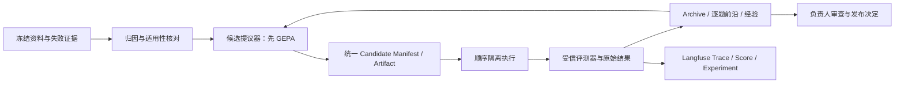

# RAG-knowledge RSI：R0 学习与实施映射

日期：2026-10-30。目标分支 `codex/pdf-parser-migration`，本地基线 HEAD `5e366330e80a3d2e4466139fbed7359f40f949e6`。

**R0 交付范围：研究、源码静态审查、既有证据核对和设计。** 未安装 GEPA/DGM/AFlow，未执行其优化器、测试或示例，未调用付费模型，未重新评测 E1/E2，也未修改 RAG 业务代码。R1 需要负责人审核后另行启动。

证据标记：**[官方事实]** 来自指定论文或固定版本官方源码；**[本地事实]** 来自当前项目源码/保存的实际结果或本次只读 ECS 检查；**[工程推断]** 是推荐设计；**[待验证假设]** 尚不能以实现或效果宣布通过。研究完成 PASS 不等于三种算法接入或效果 PASS。

## 1. 研究基线与结论

|路线|论文版本|本次固定的官方仓库 Commit|定位|
|---|---|---|---|
|GEPA|[2507.19457 v1](https://arxiv.org/html/2507.19457v1)|[`1a435101551629de917a37110b29805268a98bfd`](https://github.com/gepa-ai/gepa/tree/1a435101551629de917a37110b29805268a98bfd)|文本组件反射优化；首轮优先复用|
|DGM|[2505.22954 v1](https://arxiv.org/html/2505.22954v1)|[`a565fd2d1dca504ef5104a7cc0f3bdc4ab9b4fd2`](https://github.com/jennyzzt/dgm/tree/a565fd2d1dca504ef5104a7cc0f3bdc4ab9b4fd2)|代码父代恢复、增量继承、候选 Archive|
|AFlow|[2410.10762 v4](https://arxiv.org/html/2410.10762v4)|[`3f457218fc716093fe53f6df8a5d5e6379d66346`](https://github.com/FoundationAgents/AFlow/tree/3f457218fc716093fe53f6df8a5d5e6379d66346)|代码表示的工作流搜索与树状经验|

仓库只做 shallow、blob-filtered、no-checkout 拉取和相关源码归档阅读。GitHub API 的匿名请求曾返回 403 限流，随后换用 Git 拉取成功；AFlow v1/v3 HTML 不可取，改读 v4 HTML/PDF。论文版本与今天的仓库版本不是同一发布快照，以下专门标出差异。

**[工程推断] 推荐一个候选生命周期，加三种可替换提议器。** R1 只接入 GEPA 的文本候选；DGM/AFlow 暂时作为统一 Manifest、继承与工作流表示的设计依据。不启动三个控制台、三套实验数据库或三套评分口径。

长期目标是系统能根据历史反馈提出下一轮改进。若只有固定优化器反复调 RAG 参数，应称为自动迭代优化；未来优化器自身的 Memory、Skill、Workflow、Code 也成为受控候选，才逐步接近更强的 RSI。评测器、Gold、费用门和权限边界保持在候选之外，避免系统靠改裁判获得分数。

## 2. 三种机制与源码核对

### 2.1 GEPA：失败反馈如何形成 Prompt 候选

**[官方事实]** 论文使用系统轨迹和自然语言反馈进行 Reflective Mutation；候选由具名组件文本组成，每次可以针对组件更新，保留父代关系。先在 minibatch 比较，再对进入池的候选做验证评估。其 instance Pareto 选择保存不同问题上的优胜策略；论文最终仍返回验证集平均分最好的候选，不能据此认为“官方返回值已经解决所有多目标取舍”。

当前源码可以直接核对：

|实现位置|实际职责|
|---|---|
|[`core/adapter.py`](https://github.com/gepa-ai/gepa/blob/1a435101551629de917a37110b29805268a98bfd/src/gepa/core/adapter.py) `GEPAAdapter.evaluate`|执行 candidate，返回逐例 outputs、数值 scores、可选 trajectories/objective_scores|
|同文件 `make_reflective_dataset`|把已捕获的执行/评审信息转为按组件组织的反射材料|
|同文件 `propose_new_texts` / `ProposalFn`|可选自定义模型调用接线；复用项目调用记账与授权，不重写搜索算法|
|[`proposer/reflective_mutation/reflective_mutation.py`](https://github.com/gepa-ai/gepa/blob/1a435101551629de917a37110b29805268a98bfd/src/gepa/proposer/reflective_mutation/reflective_mutation.py) `ReflectiveMutationProposer`|选父代/组件、取小批量反馈、提出组件新文本；当前还支持替换 reflection strategy|
|[`strategies/candidate_selector.py`](https://github.com/gepa-ai/gepa/blob/1a435101551629de917a37110b29805268a98bfd/src/gepa/strategies/candidate_selector.py) `ParetoCandidateSelector`|使用 `GEPAState.get_pareto_front_mapping()` 选父代，不等同于永远选平均分最高者|
|[`core/state.py`](https://github.com/gepa-ai/gepa/blob/1a435101551629de917a37110b29805268a98bfd/src/gepa/core/state.py) `GEPAState`|候选、父代、逐例分数、前沿和恢复状态；当前支持 instance/objective/hybrid/cartesian|
|[`api.py`](https://github.com/gepa-ai/gepa/blob/1a435101551629de917a37110b29805268a98bfd/src/gepa/api.py) `optimize`|公开入口；支持 `reflection_minibatch_size`、`module_selector`、`max_metric_calls`、`run_dir`、缓存、停止回调和 merge|

**[本地映射/工程推断]** 把 RAG 轨迹转换为反射包：`目标组件 + 问题 + 实际送入模型的消息/证据 + 实际答案 + 逐项评审理由 + 首次证据变化位置 + 成本与结束状态`。只使用实际保存的内容；不能从检索候选重建一个模型没有看到的 Prompt，也不要求供应商暴露隐藏思考。训练集 Gold 可以进入获准的优化器反馈，但绝不加入被评测的 RAG 生成 Prompt；验证/留出 Gold 不给提议器。

**避免只追平均分：** 原始账本保留每题、每类、每个质量维度及成本；采用 instance/hybrid 前沿保留专长候选，另检查核心正确性、忠实性、引用支持性退化。当前 API 的 `objective_scores` 提供接线点，但不是未知值容器，且 minibatch 接受门仍可能阻止某些候选进入官方池。原始提出但未入池的候选仍保存在项目 Archive，标明评测覆盖，不能假称其已在完整验证集占优。最终报告展示前沿和配对变化，不能只照抄 `best` 返回值。不同成本指标方向也需明确，不能把更高费用当成更优目标。

**复用边界：** 本次 `pyproject.toml` 为 `gepa` 0.1.4、Python `>=3.10,<3.15`、核心 dependencies 为空；建议 R1 固定上述 Commit，在独立轻量环境验证 import/adapter，而不是升级正式依赖或直接装全量 extras。当前官方 [`generic_rag_adapter`](https://github.com/gepa-ai/gepa/blob/1a435101551629de917a37110b29805268a98bfd/src/gepa/adapters/generic_rag_adapter/generic_rag_adapter.py) 自带 RAG pipeline/evaluator，并有估计 Token 字段。它是接口参考，**不替换**本仓库链路，不把其默认评价或 Token 估计当成本项目事实。安装、import、恢复及 Provider 兼容性均 NOT_RUN。

### 2.2 DGM：父代、Diff、恢复和 Archive

**[官方事实]** 论文从 Archive 选择父代，让父代针对评测失败提出并实现改动。合格但暂未优于当前最好的候选也能成为后续踏脚石；外层选择/Archive 机制在论文实验中固定，并非无限制自修改。

**[官方代码事实]**：

- [`DGM_outer.py`](https://github.com/jennyzzt/dgm/blob/a565fd2d1dca504ef5104a7cc0f3bdc4ab9b4fd2/DGM_outer.py) 的 `choose_selfimproves` 默认方法 `score_child_prop`，使用 sigmoid 缩放准确率，再乘以 `1/(1+children_count)` 形成父代权重；`update_archive` 默认 `keep_all`，在资格筛选之后追加，不要求每代都变强。
- [`utils/evo_utils.py`](https://github.com/jennyzzt/dgm/blob/a565fd2d1dca504ef5104a7cc0f3bdc4ab9b4fd2/utils/evo_utils.py) 的 `get_model_patch_paths` 沿 `metadata.json.parent_commit` 回溯到 `initial`，再反转为祖先到子代的顺序。这里很多 `parent_commit` 实际是运行 ID，不应直接误解成 Git SHA。
- [`self_improve_step.py`](https://github.com/jennyzzt/dgm/blob/a565fd2d1dca504ef5104a7cc0f3bdc4ab9b4fd2/self_improve_step.py) 的 `self_improve` 新建 Docker 执行环境，依次应用祖先 Patch，然后先提交父代状态，再让编码 Agent 修改；输出 `model_patch.diff`、执行轨迹和 `metadata.json`，随后运行 SWE-bench/Polyglot harness。
- [`coding_agent.py`](https://github.com/jennyzzt/dgm/blob/a565fd2d1dca504ef5104a7cc0f3bdc4ab9b4fd2/coding_agent.py) 对传入 `base_commit` 调用 `diff_versus_commit` 导出 Patch。因此子代文件是相对已恢复父代的增量，恢复孙代要带完整祖先链，不能只应用最后一份 Diff。
- `utils/evo_utils.is_compiled_self_improve` 的实际判据主要是评测元数据字段、非空提交和任务覆盖；函数名不证明它独立执行了编译器、完整测试或安全验证。辅助函数对缺失父代 Patch 可只打印信息；本项目的版本重建不能沿用这种宽松行为。

**[工程推断]** 借鉴其“根版本＋有序父代 Delta＋不可变元数据”，但 RAG 候选必须额外保存环境/数据/索引版本，并独立验证重建后内容 Hash。缺 Patch、错父代或环境不符时标 BLOCKED，不把未复现版本加入可比较分母。Archive 保留全部尝试证据；可继续演化集合与可发布集合分开，允许低分但有效的候选留作研究，不允许绕过安全和数据身份要求。

原仓库 Docker helper 没有体现本项目所需的资源限制，修改步骤会重新 pip 安装需求并传入模型凭据。**不能直接原样运行到当前 ECS。** 本项目采用固定镜像 digest、受控环境和修改/评测分离，见第5节。

### 2.3 AFlow：搜索工作流，而不仅是 Prompt

**[官方事实]** 论文把工作流表示为调用节点、代码连接和 Operator。MCTS 搜索树中的一个节点是**完整候选工作流**，不是 RAG 内某一次检索节点。其变体使用 soft mixed probability selection、LLM code expansion、执行评估和经验回传；代码中的条件、循环和 Operator 组合让它能改变调用结构。

|官方实现|核对内容|
|---|---|
|[`scripts/optimizer.py`](https://github.com/FoundationAgents/AFlow/blob/3f457218fc716093fe53f6df8a5d5e6379d66346/scripts/optimizer.py) `Optimizer._optimize_graph`|选择历史 round，读取 graph/prompt/经验与执行日志，生成候选，评估并写回经验；默认 validation_rounds=5|
|[`optimizer_utils/data_utils.py`](https://github.com/FoundationAgents/AFlow/blob/3f457218fc716093fe53f6df8a5d5e6379d66346/scripts/optimizer_utils/data_utils.py) `select_round/_compute_probabilities`|均匀分布与按分数 softmax 混合，不是直接套用教科书 UCT 公式|
|[`optimizer_utils/graph_utils.py`](https://github.com/FoundationAgents/AFlow/blob/3f457218fc716093fe53f6df8a5d5e6379d66346/scripts/optimizer_utils/graph_utils.py) `write_graph_files/load_graph`|保存每轮 `graph.py`、`prompt.py`，动态导入 Workflow；生成代码确实会被执行|
|[`optimizer_utils/experience_utils.py`](https://github.com/FoundationAgents/AFlow/blob/3f457218fc716093fe53f6df8a5d5e6379d66346/scripts/optimizer_utils/experience_utils.py) `create_experience_data/update_experience/load_experience`|记录 father node、modification、before/after、succeed，按父节点组织成功/失败经验|
|[`HotpotQA round_1/graph.py`](https://github.com/FoundationAgents/AFlow/blob/3f457218fc716093fe53f6df8a5d5e6379d66346/workspace/HotpotQA/workflows/round_1/graph.py) `Workflow.__call__`|实际可调用的代码工作流，调用 Operator 并返回结果与用量摘要|

**版本差异与不能照搬的细节：** 论文公式示例 alpha=0.4、lambda=0.2；本次源码 `DataUtils` 默认 alpha=0.2、lambda=0.3，而且先将分数乘100。`get_top_rounds` 只有在初始轮位于选取结果时才保留它，并非无条件加入初始轮。`format_experience` 在成功和失败分支均输出禁止措辞，是本次静态观察，未执行确认影响。应借鉴树状经验结构，不能把一轮失败转成永久禁令，也不复制其中每个缺陷或无限自动重试行为。

**[工程推断]** 后续可搜索“直接检索→生成”“检索→改写→再检索→生成”“同源扩展→生成”等不同结构。使用当前 LangGraph/检索服务作为固定算子，Workflow Artifact 保存节点/边与代码，不另加一套在线 Agent 框架。只开放获准的边、算子、最大轮数和请求预算；Gold、质量阈值及评测器不成为候选可改对象。工作流收益必须重新通过同条件端到端评测，不能由论文基准推断。

### 2.4 统一比较

|维度|GEPA|DGM|AFlow|
|---|---|---|---|
|基本候选|具名文本组件字典|可恢复的编码 Agent 版本|完整代码工作流＋Prompt|
|变更信号|轨迹/评审的反射反馈|失败诊断＋编码任务|父工作流经验＋执行反馈|
|父代与搜索|候选池、逐例/目标前沿|Archive、得分与子代数加权|历史 round、soft mixed 搜索树|
|保留的价值|题型专长与可组合文本经验|多代代码踏脚石|不同连接/调用模式的经验|
|本项目首选用途|生成 Prompt；以后再分开改写/评分 Prompt|未来 Code/Skill 增量及重建|未来 Architecture/Agent Workflow|
|主要局限|标量接受门与不可靠 Judge 会误导搜索|原编码 benchmark/harness 不能直接评 RAG|动态代码必须隔离，重复评测成本高|
|R0 接入状态|NOT_RUN|NOT_RUN|NOT_RUN|

## 3. 当前项目五类改进对象

以下为当前克隆源码静态事实，不能自动等同于 ECS 正式服务版本。

|对象|实际文件/函数|可以如何版本化|本轮发现的边界|
|---|---|---|---|
|Prompt|`llm.LLMService.rewrite_query`；`agent_workflow.AgentWorkflow.analyze_intent/agent_node/grade_documents/generate_chat`；`grounded_generation.generate_grounded_candidate`|具名 UTF-8 文本/消息模板＋变量契约/Hash|提示分散在 Python 字符串中，尚无统一 Prompt Artifact 装载；R1 只做隔离单点绑定|
|Memory|`ChatRequest.messages`、`ChatService` 的 messages 转换、`AgentState.messages/execution_history`|显式会话快照；优化器的失败经验/成功策略 JSONL＋来源和适用条件|`workflow.compile()` 未提供 checkpointer；现有入参历史与单请求状态不是已经实现的长期经验学习；未确认运行时持久记忆检索|
|Skill|`tools/retrieval_tool.search_knowledge_base`；`parser.FileParser`；引用处理；`evaluation` 与现有实验脚本|Skill 说明＋输入输出契约＋可选脚本/测试清单组成的版本包|这些是已有能力入口，不代表项目已安装可加载 SKILL.md 的运行时；开发会话技能也不等于 RAG Agent Skill|
|Architecture|`AgentWorkflow.__init__`、`run_tools/process_tool_output/grade_documents/should_continue`；`ChatService._chat_stream_normal`|LangGraph 节点/边配置与对应代码/算子版本；图结构与语义 Diff|普通问答与 Agent 独立，不能把普通 Context 修复收益搬到 Agent。正式 Agent Tool 的实际参数优先于提示中建议|
|Code|`retrieval.RetrievalService/normalize_scores/deduplicate_results`、`bm25.BM25Index`、`vector_store.VectorStoreService`、`rerank.batch_rerank/expand_context`、`context_builder.build_chat_context`、`parser.FileParser._parse_pdf`、`pdf_pipeline`|根 Commit＋父代增量 Patch；必要资源契约和测试引用|现有解析/权重/阈值不在 R0 改动范围；候选必须限定模块，不能一次改变所有机制|

**[本地事实]** 当前 Agent 图为 `intent_analysis → agent → tools → process_tool_output → grading → agent`，普通闲聊转 `generate_chat`；`run_tools` 接线记录实际查询及检索参数。普通模式执行检索/可选 Rerank/扩展后，由 `build_chat_context` 组织来源成员再进入 grounded generation。独立召回接口、普通问答、Agent 三者的评测身份必须分别标记。

当前 PDF 分页迁移已存在：`FileParser._parse_pdf` 按配置选择迁移/legacy 路径，迁移入口有来源 Hash、区域和表格内容处理，不能把“以后接 OCR”当作现状。R0 不改解析器。检索旧缓存已在 `RetrievalService.search` 主路径绕过；未来在线实验可能增加真实 Embedding 请求，必须按实际路径预算，不能把接收 use_cache 参数误认为缓存命中。

存储事实：配置默认 SQLite，`database.engine` 按实际 DATABASE_URL 建引擎；BM25 的 `ChunkIndex/IndexStats` 在 SQLModel 数据中，向量客户端是 Chroma PersistentClient。源码有 Celery 包装，当前 `api/files.py` 解析接线也有 BackgroundTasks；不能由安装了 Redis/PostgreSQL 容器就推断当前项目主链依赖它们。本次进程检查确认当前 AMRAG Uvicorn 打开本项目 SQLite 文件，但没有重审全部正式环境配置。

E1/E2 可复用材料：冻结题目/Gold/来源、人工核心判断、独立 AI 来源复核、真实消息和答案 Hash、Trace/Score 关联、E2.0 完整消息、E2.1 B/C 输入及成员账本。历史 Judge 的可比较核心标签曾全部为人工 PASS，不能宣称错误识别 Precision/Recall 已校准；合成 Judge 校准候选不能冒充真实 RAG 失败。

## 4. 推荐总体架构与候选谱系

**[工程推断：设计，不是已实现系统]**



初期控制器是离线实验入口，复用本地 JSON/JSONL 和现有 Langfuse，不新建前端、数据库、Redis 队列或长期 Worker。现有问答 Agent 保持只读检索工具权限；未来负责候选修改的研究 Agent 是另一执行身份，不给正式问答 Agent 增加 shell。

统一 Manifest 的设计示例（不是一个已评测候选）：

```json
{
  "schema_version": "rsi-candidate-v1-proposed",
  "candidate_id": "example-prompt-001",
  "parent_id": "example-baseline-000",
  "additional_parent_ids": [],
  "artifact_type": "prompt",
  "artifact_hash": "UNKNOWN_NOT_CREATED",
  "artifact_ref": "local-artifact-object-id",
  "patch_or_delta": {
    "kind": "text_component_delta",
    "base_artifact_hash": "UNKNOWN_NOT_CREATED",
    "component": "generation_instruction",
    "delta_ref": "local-delta-object-id"
  },
  "base_commit": "5e366330e80a3d2e4466139fbed7359f40f949e6",
  "environment_digest": "UNKNOWN_NOT_FROZEN",
  "dataset_version": "proposed-gepa-pilot-v1",
  "evaluation_run_ids": [],
  "metrics": {"status": "NOT_RUN", "ref": null},
  "status": "NOT_RUN",
  "mutation_reason": {
    "hypothesis": "改善有来源的补充事实与引用对应关系",
    "evidence_ref": "reviewed-training-trace-reference",
    "review_status": "AI_PROPOSED"
  },
  "archive_state": "PROPOSED",
  "content_policy_ref": "owner-authorization-reference"
}
```

必须区分：`parent_id` 是候选语义父代；`base_commit` 是代码根；`artifact_hash` 是不可变内容；`environment_digest` 是镜像 digest/依赖锁和必要运行配置的组合校验，绝不包含密钥。GEPA merge 可以有多个父代，增量合并顺序和冲突决议必须显式记录，不强塞成单父代链。

|Artifact|载体|Delta/恢复|
|---|---|---|
|Prompt|具名文本或 role 消息模板；变量/渲染契约|文本/JSON 字段差异，恢复后按字节 Hash 验证|
|Memory|经核实经验条目，含来源、scope、正反例、适用条件、置信状态|增加/修订条目事件；历史对话事实不可被候选改写|
|Skill|说明、工具契约、允许脚本和测试引用组成的 bundle|文件清单/内容 Hash 与包差异；扩展能力权限单独批准|
|Workflow|节点/边配置或代码工作流＋算子版本|图语义 Diff＋代码差异；记录最大调用轮数与实际执行路径|
|Code|根 Commit＋父代增量 Patch|有序应用 Patch，含新增文件/删除/文件模式及必要二进制对象引用|

Hash 规则本身版本化：文本保存真实 UTF-8 字节和换行规范，不为便于比较擅自 trim；JSON 可固定 canonical 序列化。Artifact 核心清单不包含会后补的 metrics/Trace ID，避免内容 Hash 循环依赖；运行结果和状态追加事件，再生成带评测引用的 Manifest 快照，不静默覆盖旧版本。

Archive 是证据档案，不是正式发布列表：PROPOSED/EVALUATED/ELIGIBLE/PROMOTED 等为候选生命周期，PASS/FAIL/PARTIAL/UNKNOWN 等为检验结论，两者分别存储。未优于父代的有效候选可保留；越权、篡改 Gold、身份不一致的候选留失败证据，但不成为可发布父代。任何进入正式环境的操作仍由负责人决定。

## 5. Worktree、Docker 与 Patch 的组合

|方案|优点|局限|推荐角色|
|---|---|---|---|
|Git Worktree|代码差异审查方便，共享 Git 对象，避免复制整个仓库历史|不是安全边界，仍能访问宿主文件/网络；忽略的数据库不自动隔离|宿主侧审查/调试，一次一个候选；R0 未创建|
|Docker 临时容器|固定运行环境，可设 CPU/内存/挂载/网络|默认资源无限制；挂载宿主目录/Socket 会破坏隔离；不是虚拟机级保证|修改和任务执行隔离，镜像按 digest 复用|
|DGM Patch 继承|小体积保存多代，重建谱系明确|只有最后一份 Diff 无法恢复多代；依赖/数据差异不在 Patch 内|长期候选载体与恢复机制|
|组合|便于审查、可隔离、可追溯且节省空间|需严格区分根版本、父代状态及环境/数据身份|推荐；R1 Prompt 可先不需要修改容器|

官方依据：[Git Worktree](https://git-scm.com/docs/git-worktree)、[Docker 资源限制](https://docs.docker.com/engine/containers/resource_constraints/)。下面为本项目设计约束，并非声称 DGM 原代码已经满足：

1. **恢复父代**：取已批准的根 Commit 和父代 Artifact 清单，按祖先顺序应用 parent-relative Patch/非代码 Delta；先做适用性检查，禁止 fuzzy apply 后继续宣称一致；Hash、锁文件、模型和数据版本一致才允许执行。可周期性保存内容快照加速恢复，但不每代复制语料或索引。
2. **修改容器与评测分离**：未来 Code/Workflow mutation 在临时 writable workspace 中进行，拿不到 Gold、正式 DB、正式 Redis、Docker Socket 或共享 Git 元数据。宿主从受控输出导出 Diff，复核范围后再建立候选。评测执行容器从同一不可变候选重新恢复，不复用修改时的脏环境。
3. **受信裁判在候选之外**：候选执行只接收问题/获准上下文，返回答案/事件；Gold 和评测器由另一受信进程持有，不能把 Gold 挂进运行未知候选代码的同一容器。否则只读挂载也不能阻止候选偷看答案。
4. **保存 Patch**：相对已恢复父代导出 binary-capable Diff，明确新增文件与二进制对象；宿主校验不存在凭据/私有快照和越界路径。`model_patch.diff` 只是 Code Artifact 名称，Prompt/Memory/Skill 不因此转成 Python Patch。
5. **复现**：环境 digest＋根 Commit＋全部父 Delta＋Artifact Hash＋题集/拆分/原文/Chunk/索引版本＋模型/Prompt/参数/授权版本。恢复失败记 BLOCKED，不能换成相近版本继续比较。原始结果/日志/UNKNOWN 账本永不重置。
6. **数据隔离**：R1 Prompt 用冻结消息，不读 DB、不创建索引、不跑 Embedding。后续 Workflow/Code 才按一次性冻结的小型 KB 快照试验。SQLite 需一致性备份处理 WAL，不能对活库直接假定 `immutable=1` 安全；Chroma 客户端可能写元数据，不能因 API 名称 query 就把正式目录以读写方式挂载。只读底座＋候选 scratch/COW 是否兼容须先验证；失败时建立一次受控小快照，不每题全量复制。
7. **权限与资源**：默认非 root、cap-drop、无宿主 Socket、限制 PID/CPU/内存和可写目录。离线构建无网络；需要真实模型时由受信调用接线持有凭据与预算。Prompt 试点只需固定可信执行器，复杂网络代理不是 R1 前置建设；未来不可信 Code 候选外发才需要另行审查调用代理。

## 6. 评测、脱敏与判定原则

**[工程推断] 双层判定，避免无意义严格。**

- 安全、Gold/原文/索引身份、参数实际传递、请求次数、UNKNOWN 不重放属于硬约束；违反即不能将结果标可发布。未授权内容或密钥外发需要停止相关步骤。
- 同义表达、合理舍入、等价格式不做硬拒绝。单位/对象/时期/否定或字段口径错才是实质错误。补充内容有关联且受来源支持可接受；同一表格的合理组引用可接受，不要求每行机械重复引用。
- 核心正确性、完整性、Faithfulness、Citation Support、Citation Coverage 独立记录；部分正确用 PARTIAL。引用都支持已标注声明不等于所有补充声明都有引用，不能把二者混为一个指标。
- UNKNOWN、空答案、截断、失败、跳过单列。总计划数、实际调用数、已返回数、可判题数和配对共同可判数都报告；不通过删掉失败/改 Gold 使图表全绿。不与旧版本不同配置的结果拼总准确率。
- GEPA `scores` 需要有限数值。UNKNOWN 不改成0、NaN或伪造答案分：先保存未完成运行，暂停该候选排序/必要的优化步骤，待获准评审或条件恢复。保留全部题的覆盖表；仅在明示的可判分母上报告补充指标，完整验证未完成的候选不声称占优。
- AI 提议、人工审核、确定性校验、未校准 Judge 的来源分别记录。现有 Judge 不足以自动验收，R1 先人工/来源核对，不能让模型分数直接驱动发布。

**脱敏：** Langfuse 官方支持 mask hook，但不要求把所有正文或新枚举都 Hash。现有 `observability.sanitize` 在 E2.1 将 C 等受控字段误哈希，属于项目自定义策略问题。后续设计应按数据类别与授权记录：

|数据|策略|
|---|---|
|密钥、Authorization、连接凭据|始终拒绝记录；不放入 Candidate/Cloud/公开 Git|
|受控 candidate/run/arm/阶段/状态/规则版本|按类型直接记录，不因出现新合法值就整体 Hash|
|未经授权的文档/问题/答案/Prompt|本地受限保存，Cloud 仅可诊断的 Hash/引用；无必要原始内容不外发|
|已授权评测正文|按精确 dataset/qid/source/角色/项目范围允许完整记录；混合消息要核对全部来源，不一律 Hash|
|训练反射包/Gold|优化器与任务生成分开授权；不给验证/留出内容，不注入任务生成 Prompt|
|公开 GitHub 报告|只放方法、代码和脱敏派生结果；私有正文、完整 Gold、原始路径/快照留本地|

模型供应商外发授权与 Langfuse Cloud 存储授权分开检查。授权不齐只阻断相应外发/诊断能力，能完成的本地评测继续。遥测不可用、UI问题、非关键展示格式不使正常问答整体失败；缺陷需要记录，不为追观测全绿重发模型 UNKNOWN。官方参考：[Masking](https://langfuse.com/docs/observability/features/masking)、[Dataset/Experiment](https://langfuse.com/docs/evaluation/experiments/datasets)。

Langfuse 继续承载每题实际 Trace、Score、Dataset/Experiment，增加 candidate_id、parent_id、artifact_hash、base_commit、environment/data/evaluator版本及 mutation_reason 引用。每次真实模型调用一个 Generation；零模型回放只建 Context/实验节点。Cloud/LF 并非候选代码仓库，源码和 Artifact 保存在本地/Git，使用引用关联，不复制一套前端或评测数据库。

## 7. 第一轮 GEPA 试点设计：生成 Prompt 的补充事实引用

### 7.1 固定基线与真实失败资格

**[本地事实，已核对]** E2.0 的一个 Word B 真实 GLM 回答：核心、完整性、Faithfulness、已标注 Citation Support 为 PASS；按既有4组声明口径，Citation Coverage 为3/4。补充项目身份/标题在实际 Provider messages 的正确来源成员里，但没有引用相应成员。实际请求与冻结 B messages 相同，缺引用声明的源正文 Hash 也一致。核心是用户既有人审 PASS；成员引用覆盖缺口来自此前 AI 原文复核，R1 冻结 rubric 前应确认这种缺口确实是希望优化的质量目标，不冒充新增人工 FAIL。

这是一条**证据已送达、补充声明与引用对应不足**的合格训练诊断线索；不是核心错误，不应该向 GEPA 反馈成“答案错误”。原 Trace：[E2.0 Word B](https://us.cloud.langfuse.com/project/cmuido3u800zyad0con8gaqw1/traces/9c3fb64bda92f5cdb60d27d1b7f7441b)。私有逐项核对留在本地，公开报告不附原题/Gold/正文。

反射面错题的镜子证据当时未进入实际消息，不适合首轮纯生成 Prompt 的核心正确性训练；可用作“资料不足时不要声称整库没有”的诊断/回归案例。神经网络图像层数等题也必须先确认模型实际看到的图像/文字证据，不能只看 Gold 判成 Prompt 故障。E2.0 的 Context 送达修复、E2.1 的成员裁剪属于 Code/上下文机制，首轮不与 Prompt 同时改变。

**基线 P0** 来自 `grounded_generation.generate_grounded_candidate`：

```text
请根据以下参考资料回答用户问题。资料不足时请如实说明，并适当引用来源。

资料：
{evidence}
```

`{evidence}` 的实际 `[编号] 来源/位置/正文` 渲染以及用户/历史消息保持原样。以上指令与占位模板 Hash 为 `0b5e914fe3846b7cbf6238f76c67d75ee9bf741711e1efae182d38e58cb9b7e8`，不是任何真实问题完整 Prompt 的 Hash。

**[工程推断] 首轮只优化 `generation_instruction` 一个组件。** 系统证据保护/错误状态接线不在可变范围；参考资料插槽不可删除、重排、掺 Gold 或改编号。固定 E2.0 B 完整扩展上下文，不启用 E2.1 C，从而归因于 Prompt。任务模型建议沿用该已确认案例的隔离 GLM 身份，temperature=0.7、max_tokens=4096；正式默认 Chat 模型保持原状，R1 开始前由负责人确认临时试验配置及调用额度。

### 7.2 数据拆分与反射包

建议先冻结 **12道独立题，train4 / validation4 / holdout4**，优先选已有资料/Gold/人工或可靠来源复核。训练中至少1条上述真实引用覆盖缺口，配上有依据的正常数值/事实/补充信息对照；验证覆盖 Word/Excel/普通事实与资料不足边界；留出按文档/source SHA/相关段落群组隔离。Word 同一报告的标题、预算、成本题不能一部分给 train、一部分当独立 holdout；HotpotQA 共用支持段落也按组处理。

当前只实质资格确认了上述1条 Prompt 线索；其他11题的最终名单、跨组去重和授权 **NOT_RUN**，由 R1 零调用预检冻结。若现有材料凑不够，标 BLOCKED，不为凑12题构造假失败或扩建新数据集。已有30/250题不重跑；若历史结果没有当前输入、参数和版本身份，保留作诊断，不混入新比较。留出已有项目历史暴露时需标明，不宣称严格未见的全新测试分布；至少保证未来提议器拿不到其问题、Gold和Trace。

每个训练反射包包含：旧组件、实际输入引用、实际输出、独立维度判定、支持/缺失位置、评审来源/状态、可允许改动与实际开销。目标反馈示例是“某补充身份声明由送入的另一来源成员支持，但未关联该引用”；不是强制某个句式，也不把 Gold答案写进新 Prompt。验证/留出只向控制器提供判定和必要的选择统计，不把原文/答案反向加入训练反射。

### 7.3 官方库接线与候选数量

R1 先做无网络替身的 adapter/import/状态恢复冒烟，再申请真实额度。本轮不安装不运行。建议使用上述固定官方版本的 `gepa.optimize`：

- `seed_candidate={"generation_instruction": P0}`；显式 trainset 和 valset，绝不依赖 valset 缺省回用 trainset。
- 自定义轻量 `GEPAAdapter`，调用现有生成接线，复用实际请求记账；`capture_traces=True` 返回真实可见操作和来源判断；`make_reflective_dataset` 只给可授权训练反馈。
- `reflection_minibatch_size=2`、`module_selector="round_robin"`（首轮只有一个组件）、`candidate_selection_strategy="pareto"`；完整维度数值已齐备时使用当前支持的 `frontier_type="hybrid"`。未验证该版本实际 import/API 兼容，不能把此设计写成已运行命令。
- 最多2次单组件 mutation，得到 P0＋至多P1/P2；`use_merge=False`，不引入多代交叉或并行反射。官方停止回调配合外层真实调用预算，不只相信 `max_metric_calls` 就等价于付费 HTTP 次数上限。
- 提议方向由实际反射生成，例如鼓励相关补充事实找到支持它的来源成员、证据不足时区分不确定范围；这些是**待验证假设**，不是 R0 已生成、已批准的候选 Prompt。

当前 Judge 不能直接当可信自动奖励。R1 的 `evaluate` 先持久化真实结果，由人/来源审核补齐判定后，才返回数值 `EvaluationBatch`；等待评审不占 Provider timeout。原始结果缓存与候选登记必须先于返回/异常保存，恢复时只回放已完成答案及已审分数，不重新生成或重发 UNKNOWN。官方 run_dir/resume 与这种人工暂停接线的兼容性是 R1 替身预检项；若不支持先修接线或停止，不另写完整 GEPA 替代品。

### 7.4 指标、前沿与验收

每题独立记录 Core Correctness、Completeness、Faithfulness、Citation Support、Citation Coverage；PASS/PARTIAL/FAIL 分别可映射1/0.5/0用于已判的质量项，UNKNOWN 不映射。必要时按固定权重提供一个 GEPA 标量接受信号，但保留 objective_scores 和逐题分数；任何平均分不能补偿关键事实捏造、引用指错来源或数据越权。

对于这条训练线索，Citation Support 本就 PASS，真正希望改善的是 Citation Coverage，不能声称它由0变1。候选也不能通过删除用户要求的要点降低完整性来“提高忠实度”，或通过给所有句子堆编号提高覆盖。允许同表组引用、同义表达和有来源的相关补充；不加入严格运行时答案校验。

验证集展示逐题 P0/P1/P2 配对和各格式/失败类型分组、完整性/忠实性/支持性与 Token/延迟/费用，不只展示均值。官方前沿保留题型专长；项目 Archive 保存全部候选与评测覆盖，再画已完成候选的质量—成本前沿。主候选由预先声明的规则选出，holdout只比较P0和该候选一次；若失败不回看 holdout 再改同一轮 Prompt。

当缺口改善且已知核心/忠实性/支持性对照不退化，可标“小规模试点有条件通过”；若仍有争议，PARTIAL/UNKNOWN，保持基线。样本少、每臂一次、模型版本漂移存在时，不宣称统计显著、总体准确率提高或部署可直接通过。

### 7.5 预算设计（未获执行授权）

在4/4/4拆分、两轮、每轮训练 minibatch=2、每个候选仅一次同配置答案的前提下：

|项目|最多新增请求|
|---|---:|
|P0 验证集4题|4次任务生成|
|2轮父/子训练小批量比较：每轮2＋2|8次任务生成|
|P1/P2 各验证4题；官方跳过者的有限补评也计在此额度内|8次任务生成|
|holdout：P0与一个已选候选各4题|8次任务生成|
|2次单组件反射|2次反射生成|
|合计上限|30次发送尝试，其中任务28、反射2|

已有同身份、已完成缓存可复用并减少调用，不能增加预算；若官方引擎请求更多轮次/重复评估，外层拒绝新预约并停止，不为了跑完库默认策略扩大额度。Judge、Embedding、Rerank、VLM均为0。所有调用串行、SDK自动重试为0，UNKNOWN保留且不重发。每次预约先记录本地 request_id、角色、candidate/input/配置Hash；有响应后再追加 provider_request_id、finish_reason、usage与状态。

统一输出上限4096时，30次的输出预约上限为122,880 Token，**不是预计消费**。输入和实际金额在题单/候选/模型价格未冻结前 UNKNOWN；R1 需要以真实编译消息、可核实价格及保守预留向负责人提交预算。Tokenizer尚缺不妨碍本轮设计，但不能伪造精确 Context Token 或费用；没有获批调用授权不发送。此处不是延续或重用 E2.0 旧4次额度。

## 8. ECS 资源、候选持久化与清理边界

**[实测快照]** 2026-10-30 17:09–17:21（Asia/Shanghai）：2个CPU；可见内存约3.54 GiB，MemAvailable约1.80–1.82 GiB，无Swap；根盘剩余约8.47 GiB。当前 RAG Uvicorn PSS约733 MiB，三个既有数据库/Redis容器实际Docker内存合计约262 MiB，另有宿主数据库/评测注册服务与系统代理。运行中的 PostgreSQL/Redis包括其他项目，不能因为看见它们就把本仓库数据库方案改成 PostgreSQL。

**[清理前实测]** 旧实验目录存在18套 Chroma 目录，合计约10.30 GiB；并非 R0 新建。本轮研究源码下载只在本机，不在 ECS 装模型或增加常驻优化器。负责人随后明确批准删除重复索引：逐文件完整 SHA256、集合身份/记录数核对后，按14套69,814条、3套37,271条、1套1条三个组各保留一套，删除15套重复存储，释放9,942,544,384字节（约9.26 GiB）。不同字节的原版本保存48,802字节差异档案，并通过从保留基线与持久化差异流式重建的原 SHA256 校验；没有把近似副本说成逐字节完全相同。删除前核对进程FD、内存映射和运行容器挂载。原资料、Gold/qrel与历史结果没有删除；实际恢复成完整目录并重开Chroma未运行，不能把哈希重建校验写成运行验收。

**[工程推断]** R1 只读冻结 Context，无新持久测试库；一次仅一个候选/一个执行容器。建议初始内存限额512 MiB，若必要依赖冒烟证明不足，先检查峰值再申请不超过768 MiB；CPU1核、PID128、明确截止时间。宿主需保留约1 GiB运行余量，启动前重新检查 MemAvailable，快照值不保证忙时够用；失败记 BLOCKED，不盲目并发。Docker实际限制能力、峰值和依赖镜像大小目前 NOT_RUN。

镜像/依赖按 digest 复用，不每代 pip install、不复制一套完整 Chroma/SQLite。候选长期保存 Manifest、Prompt/Delta、必要 Diff、逐题输出和日志引用；大正文/索引保存一份版本化底座，候选只引用 Hash。新实验可写数据使用受限 scratch，并在证据导出/验收后按负责人认可的保留策略清理；历史材料本轮不自动删除。

研究过程中负责人另行要求清点并清理无用已停止Docker容器：579个全部删除，停止容器剩余0，运行中3个容器身份不变；日志开启者先保存日志，236个关闭日志功能的容器另行确认后删除。该操作与上述重复索引去重属于明确授权的运维收尾，与R0运行RSI算法无关。镜像、数据卷与运行服务未删除/停止，根盘可用空间清理后约17.82 GiB。前后清单、完整文件Hash、差异与恢复说明保存在受限运维记录；没有为留备份再复制整套大索引。项目根目录AGENTS.md已按负责人要求记录优先复用与临时资源收尾规则，不把运维成功写成RSI试点成功。

## 9. 状态、未确定项与 R0 停止条件

|事项|状态|说明|
|---|---|---|
|三篇原论文/三套固定官方源码研究|PASS|只做静态阅读；论文/代码差异明确列出|
|当前五类对象、真实调用/存储边界映射|PASS（静态已核对范围）|未穷尽全部生产环境；没有承诺已有长期 Memory/Skill 装载器|
|首轮真实失败线索资格核对|PASS|实际输入已包含补充身份来源，覆盖3/4；AI覆盖判断仍需R1 rubric确认|
|完整12题拆分、必要结构/语义 rubric冻结|NOT_RUN|需源文档群组去重；不伪造已冻结名单|
|GEPA安装/import、人工反馈恢复、Provider接线|NOT_RUN|固定版本后先无调用冒烟，不原样替换当前RAG|
|DGM/AFlow运行或效果|NOT_RUN|后续只借鉴机制，未接入|
|候选Docker资源/隔离/重建实测|NOT_RUN|本轮未起候选容器或执行未知代码|
|Judge自动评分可靠性|UNKNOWN|已有正例一致性不足以确认错误识别能力|
|精确Tokenizer/供应商模型revision/输入和金额预算|UNKNOWN|不能由库已安装或模型名字推断|
|真实Parent恢复、非空Hybrid有效补救|BLOCKED（既有独立项）|不由Prompt方案设计解除|
|新模型调用、业务代码修改、正式服务切换、Git提交/推送|NOT_RUN|本轮无这些授权|

执行证据：本地 `git status/rev-parse`、官方 `git clone --depth 1 --filter=blob:none --no-checkout` 及 `git archive/git show` 均实际执行；官方源码未 import/运行。ECS只读资源/进程/磁盘命令退出0；失败线索读取原实际请求并与冻结消息比较、来源Hash匹配，退出0。GitHub API403、HTML不可取和若干初始搜索路径错误已保留；没有将失败命令写成通过。R0未运行pytest或历史RAG评测，因为没有实施业务变更。

**交付后停止。** 建议负责人先审核单组件试点目标、12题分组原则、人工反馈接线与30次保守调用设计，再决定是否进入R1。R0不自动生成并执行候选、不替换正式Prompt，也不因设计文档完整就自称已完成RSI能力验收。
